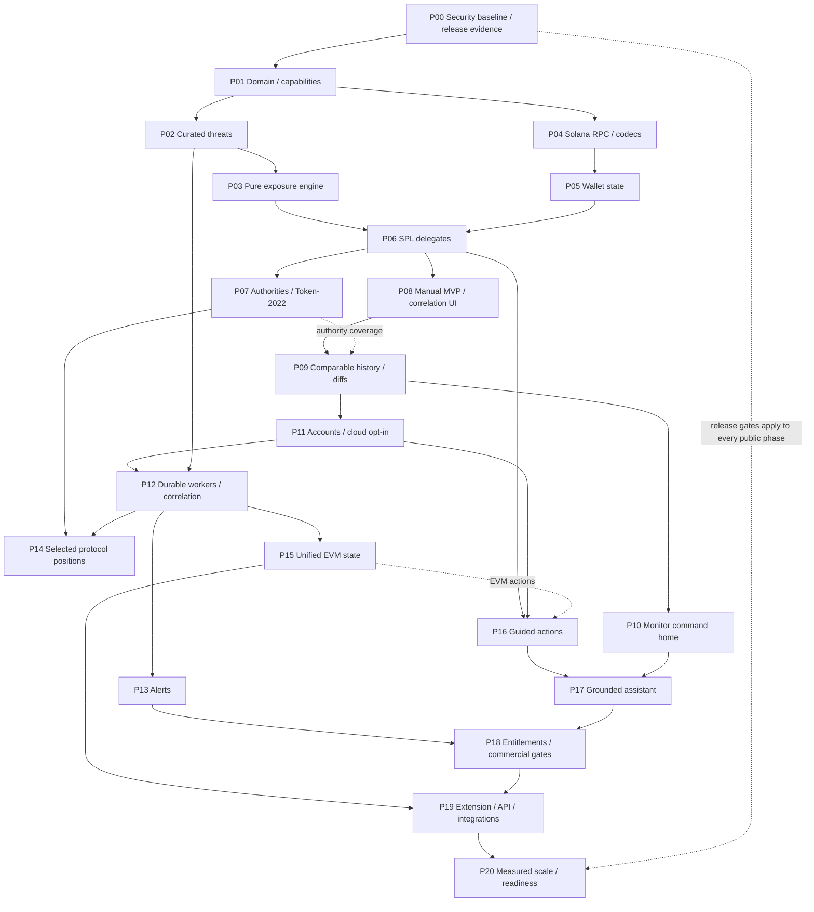

# Sigil vNext: Continuous Exposure Monitoring Roadmap

## Active Execution Override: Colosseum 24-Hour Sprint

2026-10-11: Kevin explicitly reprioritized the complete project for Crypto World's Fair and approved existing EVM tools plus a narrow manual Solana wallet/delegate check without accounts or always-on monitoring. [The pre/post-Colosseum roadmap](colosseum-24h-roadmap.md) now governs execution order and maps every phase and audit group. Original phase contracts below remain the long-term backlog; only named pre slices are required before submission. P00 full closure is not a prerequisite to private demo implementation. Audit history and applicable security/privacy boundaries remain intact; this is not legal release clearance.

Date: 2026-10-08. Status: proposed architecture and implementation roadmap; not approval to implement or release.
Reviewed baseline: `7d6f53a5cbb5da8bdb1865b5e299ea90c9430994`, clean `main` at review start.
Input: Kevin's 35-section transformation brief supplied on 2026-10-08. All requirements are mapped below.

> For agentic workers: implement only an approved phase, using `superpowers:writing-plans` to produce its task-level red/green plan and `superpowers:executing-plans` or `superpowers:subagent-driven-development` for execution. This document defines phase contracts; it does not authorize production migrations, paid providers, account changes, notifications or transactions.

**Goal:** evolve the existing Sigil toolkit into a cross-chain security companion answering "Do I need to do anything?", with Solana as the first deep continuous-exposure adapter.
**Architecture:** preserve React/Vite, Express, OpenAPI/Orval/Zod, Drizzle/PostgreSQL and the advisory extension. Add a deterministic chain-neutral exposure core, chain-specific evidence adapters and incremental optional cloud processing.
**Tech stack:** current pnpm/Node 24/TypeScript/React 19/Vite 7/Express 5/Drizzle/Neon/Vercel; a reviewed Solana SDK/decoder is new work, not an existing dependency.

## 1. Executive Summary

Sigil already has useful investigation tools, a local EVM watchlist/monitor, structured findings and conservative execution checks. It does **not** have a continuously running wallet service, accounts, a wallet-state database, a current threat registry, a Solana adapter, an alert-delivery system or an exposure engine. These are additions, not renames of existing code.

Recommended progression:

1. P00: finish security/release follow-through and baseline correctness, preserving the existing `NO_GO` until evidence supports reassessment.
2. P01-P06 + P08: deliver a narrow **local/manual Solana delegate exposure vertical slice**, with curated threats and evidence-scoped negative results. Existing EVM tools remain available.
3. P07, P09-P13: expand authority coverage, history, command UI, explicit cloud opt-in, bounded workers and meaningful alerts. Only this stage supports browser-closed monitoring.
4. P14-P20: add selected protocol positions, migrate EVM evidence into the same model, guided remediation, grounded assistance, entitlements, integrations and measured scale.

Threats, permissions, hygiene observations and actionable exposures are different objects. A known exploit plus an old interaction is not evidence of current wallet compromise. Absence of collected data is never "no exposure". AI explains accepted evidence; it cannot confirm threats or alter exposure state.

This is documentation-only planning, not a new legal audit or full security scan. Existing audit artifacts remain authoritative. Primary provider/chain documentation was checked for planning; paid services were not activated. No real `.env`, credentials, production database contents or private account settings were inspected.

## 2. Current State

### Repository Evidence Inventory

Paths below are repository-relative for portability. Existing paths were inspected; paths marked **new** later are proposals, not implemented modules. No root `README.md`, `AGENTS.md`, `.planning/` or `.github/` directory was found by discovery. `overview.md` is the current README-style overview; `replit.md` is legacy architecture context. No dirty audit worktree was present at baseline; prior remediation is committed on `main`.

| Surface | Verified evidence | State and limitation |
| --- | --- | --- |
| Workspace | `package.json`, `pnpm-workspace.yaml`, artifact/lib manifests | Implemented monorepo; root typecheck/build, no root unified test script or inspected CI workflow. |
| Product | `overview.md`, `sigil-whitepaper.md` section 17, May product/monitor specs | Directional docs exist. Some delivered claims are stale: full simulation, network count, domain-age detection and 1.0.3 release references must not be read as current capability. |
| Web | `artifacts/sigil/src/App.tsx`, `pages/home.tsx`, `pages/wallet-monitor.tsx`, `pages/watchlist.tsx`, `components/layout/Layout.tsx` | Implemented manual tools and `/monitor`; current home is scanner-focused, not a monitoring command center. Home still contains unsubstantiated `$10B+` analyzed / `50+` signals per scan / `10` chains statistics and a Tornado Cash OFAC example label; these require claim/source reconciliation in P00, not inheritance into vNext. |
| Watchlist | `artifacts/sigil/src/lib/watchlist.ts` and tests | Implemented EVM-only `sigil.addressWatchlist.v1`, public addresses/labels/summaries in localStorage, JSON import/export. Imported summary metadata is not authoritative evidence. |
| Wallet Monitor v1 | `src/lib/wallet-monitor.ts`, `pages/wallet-monitor.tsx`, tests | Implemented manual refresh through approval health; sequential refresh-all, hygiene arithmetic, fix-first list. No scheduled browser-closed scans, durable state history or threat correlation. |
| Approval health | `artifacts/api-server/src/routes/sigil/approvals.ts`, `approval-health.ts`, `approvals.test.ts` | Partially implemented as current-state monitoring: explorer logs from block 0 to latest, latest event per token/spender pair, no complete pagination or current allowance reads in this endpoint. Reports `limited`; unavailable branch has zero counters, not proof of no permissions. |
| Approval Inspector | `index.ts`, `approvals` helpers, `components/sigil/ApprovalInspector.tsx` | Implemented decoded-intent inspection. The transaction evidence adapter has bounded permission reads for some supported interfaces; not a full wallet permission inventory. |
| Scanner | `index.ts`, `ethereum.ts`, `transaction-evidence.ts`, `analysis-adapters.ts`, `validated-findings.ts`, `ai-analyzer.ts` | Implemented findings-v2, request-local evidence, separate risk/uncertainty, bounded token state/current ABI provenance, fail-closed input/provider/AI handling. Internal traces and isolated deltas absent. |
| Execution checks | `simulate.ts`, `execution-check.ts`, OpenAPI v2, web/extension consumers | Implemented bounded block-pinned `eth_call`, not full simulation. Legacy `/simulate` rejects with 422; v2 distinguishes call_check/advisory_only/unavailable. No signing clearance, mined outcome, permission effect, storage simulation or historical archive guarantee. |
| Contract diff | `contract-diff.ts` | Implemented on-demand EIP-1967 slot/upgrade/ABI comparison and heuristic/AI observations; not continuous upgrade surveillance or proof of malicious semantics. |
| Entity identity | `known-entities.ts`, `validated-findings.ts` | Implemented static lowercase Ethereum-address map. Findings-v2 scopes it to mainnet; approval-health lookup does not take network. New correlation must use chain-qualified IDs, not copy that assumption. |
| Historical incidents | `incident-catalog.ts`, tests, `docs/analysis-incident-provenance.md` | Implemented bounded three-entry mainnet Euler hash catalog with exploit/victim/recovery roles and sources. Reusable provenance principles, not a live threat registry or affected-wallet list. |
| Site reputation | `artifacts/sigil/src/lib/site-reputation.ts`, extension `core.js` | Implemented local known-domain/lookalike/wording heuristics, including example blocklist entries; no domain registration-age source or comprehensive phishing feed. |
| Extension | `manifest.json`, `inject.js`, `content.js`, `background.js`, `core.js`, `popup.js`, adversarial tests | Advisory redesign implemented locally; manifest 1.0.4. Original provider independent, exactly once; hostile page can suppress/forge observations. Packaged update and installed Store/manual QA are different states. No Solana provider observation adapter. |
| Database | `lib/db/src/schema/{analyses,conversations,messages,index}.ts`, `src/index.ts`, `drizzle.config.ts` | Analyses plus generic conversations/messages only. No user ownership model; chat tables are not wired into the mounted API routes. Runtime analysis schema bootstrap uses DDL. No inspected versioned monitoring migration journal. |
| API | `lib/api-spec/openapi.yaml`, `orval.config.ts`, generated client/Zod, `scripts/check-codegen.mjs` | Implemented generated approach, custom fetch and postprocessing. Approval health/SSE/diff/Hall routes are not all described in OpenAPI; some consumers use hand-written fetch/types. Existing generated legacy simulation types do not establish runtime support. |
| Persistence/privacy | `analysis-schema.ts`, history routes, privacy/retention tests | UUID bearer links for ordinary saved results; numeric links only curated cases; public history excludes ordinary records. Bearer access is not account authentication. Daily retention excludes curated cases. Production migration/erasure evidence still open. |
| Operations | root + `artifacts/sigil/vercel.json`, both API wrapper layouts, `env.ts`, `.env.example`, `security.ts` | Vercel/Neon deployment; daily retention cron; instance-local limits/cache/Etherscan pacing. No durable monitoring queue, distributed budget limiter, source-health registry or notification delivery worker. |
| AI | `ai-analyzer.ts`, OpenRouter integration | Current DeepSeek paid slug with bounded JSON finding selection and timeout handling. No completed Decision Assistant. Generic integration utilities are not a mounted assistant product. |
| Tests/release | Node `.test.cjs`, TS assertion scripts, QA matrix, analysis-quality checkpoint, package/SBOM/codegen scripts | Substantial scoped regression coverage. Historical 288 affected tests/typecheck/API build and Aave/Euler controls are evidence for that change, not a fresh full vNext readiness run. No current test run claimed by this roadmap. |
| Accounts/billing/Solana | manifests, mounted routes, schema inventory | Planned, not implemented. No key custody or transaction broadcaster found in reviewed product routes. |

### Preserved Production Constraints

- Operator-declared current non-commercial service on Vercel Hobby; no hosting upgrade authorized by this roadmap.
- Operator-confirmed Neon Free, AWS `us-east-1`, six-hour history window; accepted agreements, transfer safeguards and backup/erasure evidence remain separate gates.
- Etherscan pacing/cache is per warm instance, not a global key-quota controller.
- Scanner SSE has a bounded overall deadline; AI has a separate bounded budget. New monitoring cannot be hidden inside long scanner requests.
- Latest Aave + Euler focused controls passed. Two Euler interfaces remain unavailable; investigate, do not weaken guards or relabel absent data as safe.

## 3. Target Product Model

One Sigil product: **BEFORE** investigation/advisory tools; **NOW** wallet state, hygiene and exposure; **AFTER** state/threat changes and alerts. Core loop: monitor -> understand -> correlate -> explain -> recommend -> watch.

First meaningful answer: action state, reason, supported remediation and verifiable evidence. Numerical heuristic scores remain advanced scanner details and cannot become compromise probabilities. Retain manual tools as investigation views; migrate `/monitor`, not a disconnected second app. Wallet connection is optional address selection; watching a public address is not proof the user owns it.

## 4. Architectural Principles

1. Deterministic detection, evidence-bound explanation; no LLM writes to threats/exposures/actions.
2. Chain-native parsers and detectors feeding shared concepts; no hex/base58 coercion or EVM approval semantics on Solana.
3. Evidence includes chain, block/slot, finality, observation time, adapter version, source and completeness. Current shape evidence is not historical execution truth.
4. Coverage/freshness and action severity are separate axes. Provider failure cannot resolve an exposure or produce green status.
5. Preserve v1 endpoints/reports/local watchlist during additive migration; no giant rewrite.
6. User wallet authorizes independently; no keys, seeds, auto-fix, wallet gating or server signing.
7. Core owns normalized data and versioned policies, not provider-specific payloads. PostgreSQL relations initially, no graph database requirement.
8. Cloud opt-in is explicit per saved wallet/account; never upload existing local watchlists silently.
9. Security/public release gates apply throughout, not only P20. Private implementation can proceed behind disabled flags while organizational evidence is pending; public rollout cannot bypass gates.

Proposed new boundaries: `lib/security-core/src/` for pure types/parsers/rules; `artifacts/api-server/src/monitoring/` for acquisition/orchestration; `src/monitoring/chains/{evm,solana}/` for chain adapters; `lib/db/src/schema/` for persistence; `src/routes/sigil/monitor*.ts` for transport. Create the shared package in P01 only; do not move all existing scanner files into it.

## 5. Target Domain Model

| Concept | Meaning / identity | Ownership |
| --- | --- | --- |
| Wallet / watch | User-selected address, label and monitoring mode; no ownership assertion | Local browser or account-private subscription |
| Chain account | Canonical chain-qualified address; Solana case-sensitive decoded 32-byte key, EVM canonical 20-byte key | Core identity with chain-specific validation |
| Asset | EVM token address or Solana mint + token program; metadata is display, never identity | Chain evidence + shared reference |
| Permission | ERC20 allowance, NFT operator/token grant, SPL delegate or supported authority relationship | Chain-specific payload under discriminated shared envelope |
| Entity | Contract, program, protocol, authority or domain; exact chain and relation type | Curated identity with provenance |
| Position | Protocol-specific claim/vault/LP/lending account with versioned decoder | Adapter evidence; never inferred from token symbol |
| Threat | Sourced incident/intelligence assertion with lifecycle, affected entities, scope and evidence confidence | Privileged registry, independent of watched users |
| Exposure | Rule-derived relationship between a current wallet state and a threat; hygiene findings remain separate | Core rule, immutable evidence refs, tenant-private projection |
| Action | Evidence-dependent recommendation/preparation; not execution authority | Core template + chain builder |
| Snapshot / change | Successful/partial acquisition and immutable diff between comparable observations | Local bounded history or opted-in private storage |
| Alert / delivery | User-visible transition and channel attempts, separate from exposure truth | Private account/notification preferences |

Recommended `ChainRef`: namespace + network identifier/genesis identity, with compatibility map for existing `mainnet`, `base`, etc. API introduces stable `chainId` without silently changing scanner enums. Reject unknown chains; never default malformed chain input to Ethereum. Distinguish account program owner from SPL token-account authority owner.

Permission key: chain + owner + token/account + permission kind + spender/delegate + tokenId where applicable. SPL current delegation state is keyed by token account; changed delegate produces a state transition rather than two simultaneously active permissions. Exposure key: tenant/watch scope + chain account + threat ID + detector/rule family + relevant permission/position/account key. Evidence revisions do not create duplicate exposure cards; reopened lifecycle increments episode number.

## 6. Threat Model

| Threat | Boundary / control / required test |
| --- | --- |
| False urgency or false reassurance | Separate hygiene, threat confirmation, scope and current state; negative results require completed fresh relevant checks; provider outages never de-escalate. |
| Forged RPC/account/ABI/metadata | Bounded bytes/accounts/depth; fixed RPC methods/servers; verify owner/program/mint/address/context; treat metadata/URL text as untrusted; malicious-response fixtures. |
| Poisoned threat feed / admin takeover | Ingestion quarantine, source policies, RBAC/MFA for publishers, review/audit trail, revoke/retract revisions; no self-published community alert. |
| Cross-chain identity spoofing | Chain-qualified entity keys and genesis check; identical EVM address on another chain cannot inherit trust/danger without evidence. |
| Tenant leak / public wallet profiling | Server-enforced ownership, nondisclosing IDs, private caching, endpoint authorization, BOLA tests; never return other watchers of a public address. |
| Hostile dApp | Extension observations never gate provider invocation; retain adversarial exactly-once/error-preservation tests and installed-build QA. |
| Remediation substitution | Re-read state; bind action to owner/chain/account/threat revision; fixed instruction/selector allowlist; reject added transfer/delegate/authority instructions or arbitrary spender URLs. |
| Alert/webhook injection or SSRF | Escaped summaries, trusted remediation destinations, authenticated inbound webhooks; restrict outbound destinations/resolved IPs/redirects and egress; no provider-controlled callbacks. |
| Replay/reorg/race/stale state | Idempotency keys, leases/fencing, finalized snapshots, sequence checks, comparable coverage; delayed jobs cannot overwrite newer state. |
| Cost/DoS abuse | Distributed quotas and bounded scan cost by account/request class; queue/backoff/concurrency caps, no unlimited historical scans, upstream spending ceilings. |
| Prompt injection / invented certainty | Structured accepted context only, ID/reference validation, no arbitrary tools or writes, independent deterministic result even if AI fails. |
| Silent service failure | Last successful scan, source staleness, job lag and delivery health visible; missed schedules trigger operator escalation. |

This is an architectural threat model, not a claim of an exhaustive security audit. Review each new authentication, worker, feed and remediation trust boundary before release.

## 7. EVM Security Model

Reuse transaction evidence, bounded RPC, ABI provenance and finding categories. Do not transplant scanner historical-call snapshots into a current wallet monitor as if they were current state.

Migration steps: approval events discover candidate token/spender pairs; paginate/check ordered log position and gaps; pin a current block; validate token contract/interface; query allowance and relevant balance at that block; record contract-reported scope, limitations and original-token provenance. Consumed allowance can change without a final approval event, so logs alone cannot confirm it. NFT `ApprovalForAll`/per-token rights and Permit2 are separate capabilities, not ERC20 aliases; add only reviewed decoders with explicit coverage. Unlimited/old approval is hygiene; confirmed active grant to an affected entity can be exposure. Contract-reported allowance does not prove arbitrary malicious token semantics or access to unrelated assets.

Preserve contract scanner, read-only check, diff, site reputation, Chrome extension and known entities. Upgrade diff is a watch signal, not automatically an incident. Ethereum-only entities become chain-scoped seeds, not a multichain authoritative sanctions feed. Retain exploit/victim/recovery distinctions in historical information; a recovery transaction never confirms present danger.

## 8. Solana Security Model

### Chain Evidence

Use reviewed SDK codecs (`@solana/kit` and official token/token-2022 builders/decoders are candidates, versions/license/API checked in P04). Do not hand-roll SPL binary layouts. Query all owner token accounts under both SPL programs; do not assume only associated token accounts. Validate account outer owner, decoded authority owner, mint/program relationship and unsigned integer ranges. SOL holdings alone are not token delegate exposure.

RPC context records actual returned slots and commitment. `minContextSlot` is a lower bound, **not** a request to read exactly that historical slot. Multi-request account/mint reads may differ in slot; retain slot range and consistency limits rather than invent an atomic snapshot. Finalized reads are default for durable state; lower-finality reactive hints remain provisional. Official method details: [owner accounts](https://solana.com/docs/rpc/http/gettokenaccountsbyowner), [batched account reads](https://solana.com/docs/rpc/http/getmultipleaccounts).

### Detectors

| Detector | Deterministic observation | Escalation rule / limitation |
| --- | --- | --- |
| SPL account delegate | Delegate, delegated amount, mint, current amount, state, owner and program | Ordinary delegate is INFO/hygiene; new/unknown is WATCH. ACTION_REQUIRED needs a confirmed affected delegate or another reviewed concrete harmful condition plus meaningful current permission. |
| Current delegated amount | `min(balanceRaw, delegatedAmountRaw)` for supported ordinary token-account delegation | Display as bounded current token-unit capability, not guaranteed transferable fiat value or future maximum; frozen/extension constraints can change meaning. Empty balance still retains future-permission watch information. |
| Mint / freeze / close authorities | Current configuration and change since comparable prior state | Ordinary retained authority is not a vulnerability; informational trust requirement unless a sourced threat/rule establishes relevant current exposure. |
| Permanent delegate | Mint-level Token-2022 authority affecting accounts of that mint | Not the ordinary account delegate; owner cannot remove it with an account-level Revoke. Explain supported alternatives; no misleading revoke button. [Primary specification](https://solana.com/docs/tokens/extensions/permanent-delegate). |
| Transfer hook / other extensions | Program/authority references, known extension state | Hook is not automatic drain or malicious program proof. Unknown extensions make relevant checks unsupported/partial. Include transfer-fee, default-frozen/pausable, confidential balances, non-transferability and scaled display considerations as capability work, not presumed common semantics. [Extension docs](https://solana.com/docs/tokens/extensions), [transfer hooks](https://solana.com/docs/tokens/extensions/transfer-hook). |
| Malicious-program association | Exact program identity + bounded interaction/position history | Past interaction alone is informational. Actionable only with a still-relevant permission/account/position relationship established by an approved detector. |
| Protocol incident | Decoded supported current position/account + incident scope | Only named versioned protocol adapters; unsupported DeFi positions stay UNSUPPORTED, not absent. |

Delegate authority need not be the same address as a program. PDA-to-program mapping requires verifiable seeds/adapter evidence or reviewed attribution, not address appearance. Revocation requires the correct authority; multisig/off-curve ownership may prevent simple user-wallet remediation. [SPL delegate semantics](https://solana.com/docs/tokens/basics/approve-delegate).

## 9. Threat Intelligence Architecture

Create append-only threat revisions and affected-entity relationships. Fields: stable ID, source external IDs, type/title, lifecycle (`draft`, `suspected`, `confirmed`, `mitigated`, `resolved`, `retracted`), severity, confidence with rationale, discovery/publication/review times, effective validity interval, chains/entities/permission predicates, recommended template IDs and evidence sources. Keep source confidence separate from rule/state confidence.

Ingestion pipeline: bounded acquisition -> normalize -> deduplicate -> quarantine -> human/source-policy approval -> publish revision -> enqueue targeted correlation. Canonical identity uses source ID + external ID, plus curator-approved incident aliases; never auto-merge incidents because titles match. Source updates retain earlier evidence; conflicting reports attach disagreement, with escalation withheld until confirmation policy passes. Resolved exploit may leave residual risky rights; retraction and resolution have different effects. Source staleness is health information, not proof an incident disappeared.

Admin v1: reviewed file/CLI import into staging with validation and audit identity; no unauthenticated admin HTTP route. Cloud-stage admin requires independent privileged authentication/RBAC. Automated ingestion cannot publish solely because an LLM or community reporter says malicious. First sources: primary project/security advisories and on-chain corroboration, curated manually. Never call the current static registry real-time sanctions compliance.

### Provider Decision Register (Planning Snapshot, 2026-10-08)

All prices/limits below are planning inputs, not contracts. Recheck at selection. For **every** provider P04/P12/P19 requires an ADR covering method/sample correctness, chain/genesis, historical boundaries, latency p50/p95, quota units/429s, API version/deprecation, cost at forecast load, retention/DPA/region/transfers, commercial redistribution/license/attribution and failover. Unknown commercial rights are a blocker, not implied permission.

| Source / option | Supplied data / depth | Limits, costs, stability | Decision / rights dependency |
| --- | --- | --- | --- |
| Solana public RPC | Current native/token/mint/account state; bounded available history, not guaranteed archive | Rate limited shared service, no product SLA; use dev/smoke, not promise production monitoring | Derive basic state from RPC. Provider quota/availability constrains coverage. [Official clusters](https://solana.com/docs/references/clusters). |
| Helius | Solana RPC/account reads, parsed history/events and webhooks; archive varies by method/product | Published Free: 1M credits/month, 10 RPC RPS; Developer $49/month, 10M/50 RPS. Billing docs and pricing require method-specific credit checks; parsing product migration is a stability risk | Candidate managed adapter, not chosen. Confirm commercial normalized-data usage, DPA and storage/redistribution before activation. [Pricing](https://www.helius.dev/pricing), [credit schedule](https://www.helius.dev/docs/billing/credits), [terms](https://www.helius.dev/terms). |
| Quicknode | Solana mainnet/devnet RPC, historical services and optional Streams/Webhooks | Credit/method/stream pricing, trial distinct from sustained free monitoring; measure method-specific rates, overage and archive SLA, no assumed flat per-request price | Alternative replaceable adapter. Exact workload quote and redistribution/processor terms unresolved. [Usage limits](https://support.quicknode.com/articles/5364861616-monthly-usage-limits), [pricing](https://www.quicknode.com/pricing), [WebSocket billing](https://www.quicknode.com/docs/solana/websocket-billing). |
| Existing Etherscan + EVM RPC | Candidate logs, current metadata/ABI, chain reads | Existing bounded pacing/fallback; Etherscan quotas differ by network/key, current ABI not historical mapping, global budget absent | Preserve; add global budget only for cloud phase. Existing accepted processing/terms still require audit evidence. |
| Primary protocol/security disclosures | Incident entity/scope, dates, mitigation and primary evidence | Irregular publication; no universal SLA/free API or machine-readable schema | Manual curation initially. Record individual source rights/attribution; link and factual summaries, not copied articles. |
| Chainabuse | Address/domain reports with source-specific confidence | Standard API documented 10 calls/month, up to 50 reports/call; partner access needed for sustained scale | Supplementary candidate only; report != confirmed threat. Chains, access, cache/storage/license rights require review. [Report API](https://docs.chainabuse.com/reference/reports-1), [limits](https://docs.chainabuse.com/docs/getting-started-2-1). |
| Public incident datasets | Regression/reference candidates | Dataset quality, chain coverage, license and update cadence vary | No bulk import chosen. Primary-confirm and license each dataset; unlicensed repos and social allegations stay research/quarantine. |
| CoinGecko | Optional pricing presentation | Existing request path lacks dedicated TTL/coalescing; price freshness/availability can fail | Not necessary for detection MVP. Never infer USD risk from absent price; commercial attribution/limits recheck before adding valuation. |
| OpenRouter | Explanations over structured evidence | Existing deadlines, token/cost constraints; routed processor and privacy depend on account/provider settings | Not threat source. Retain current contracted/privacy gate; no new provider or paid call in roadmap work. |

**Must build:** normalized model, policy/rules, negative-result semantics, diff/correlation, audit/alert idempotency and remediation validation. **RPC-derived:** supported account/mint/permission/current balance facts. **Public datasets:** reviewed seed/reference fixtures. **Provider integration:** optional history indexing, triggers and source feeds. **Manual curation:** confirmed incidents, entity attribution and safe action templates. **Future research:** broad positions, novel exploit discovery, delegated remediation; none is an MVP promise.

## 10. Exposure Engine

Implement pure functions before persistence/UI. Inputs: validated snapshot + registry revision + capability/policy version. Outputs: hygiene observations, exposure decisions, recommended action templates and check scope. Preserve existing finding categories; exposure result has its own version (`exposure-v1`) rather than silently extending findings-v2 semantics.

Evaluation gates: exact chain/entity match -> threat affected predicate -> supported state relationship -> freshness/finality/completeness -> rule evidence -> actionability/severity/confidence. Deterministic matched evidence refs must resolve. Suspected entity/report alone is WATCH, not CRITICAL. Severity cannot be raised by an explanation model or by multiplying correlated uncertainty signals.

Negative status is per threat + wallet + requested capability scope:

| Status | Meaning |
| --- | --- |
| `NO_EXPOSURE_FOUND` | All required supported checks for this explicitly described scope completed fresh, with no matching relation. Not proof of universal wallet safety. |
| `EXPOSURE_FOUND` | One or more accepted supported matches; coverage may still be partial for other dimensions. |
| `NOT_CHECKED` | No evaluation completed, including no wallets supplied. |
| `PARTIALLY_CHECKED` | Some relevant dimensions/accounts/history unexamined or capped. Negative global conclusion prohibited. |
| `DATA_UNAVAILABLE` | Required evidence failed/malformed/stale; prior finding is not resolved. |
| `UNSUPPORTED` | Requested chain, extension or relationship not implemented. |

Materialize current canonical entity edges/permissions/positions, snapshot metadata, accepted exposure projections and lifecycle transitions for cloud subscriptions. Compute manual/local match on demand; do not persist every anonymous scan as a cloud watch. Keep historical snapshot/diff revisions bounded by retention. Reverse index `(chain_id, entity_id, relation_kind, active)` selects wallets for new threats; wallet changes look up relevant threat-entity rows. Never scan all wallets for every threat or rely on provider symbol matching.

Threat revisions and wallet-state changes both enqueue the same idempotent correlation function. Revision fanout takes the deduplicated union of wallets indexed under the **previous affected scope**, the **new affected scope**, and **existing exposures for that threat**, including entity removal/replacement and narrowed predicates. Do not select candidates only from the new entities. Jobs carry old/new registry revision and a fencing condition: superseded work cannot overwrite a newer threat/exposure projection; recheck watch authorization before every private write/send. Preserve earlier evidence and record why a projection was corrected.

A threat match first revalidates stale state or emits a coverage warning, not an invented current balance. Resolving an exposure requires a comparable fresh scan disproving the relationship, an accepted retraction, or an explicit rule-reviewed resolution path. Retraction/narrowed scope can invalidate an attributed exposure without proving the permission was removed or the whole wallet is safe. Disappearance from a capped response is not removal. Corrective alerts distinguish intelligence correction from confirmed permission remediation.

## 11. Monitoring Architecture

**Local/manual:** no account, locally saved addresses/labels; explicit API requests send public addresses to providers, which is disclosed (local storage does not mean zero server processing). Persist only bounded local summaries/history. Refresh failure retains last accepted result and marks it stale/unavailable.

**Optional cloud:** authenticated watches/subscriptions, explicit per-wallet import/consent record, durable jobs, state snapshots and alert preferences. Account/backend/privacy gates precede activation. Shared acquisition of a public chain account may deduplicate provider work, but tenant labels, subscription existence, preferences and alert state remain isolated; no public watcher count.

Start with PostgreSQL jobs + transactional outbox and a small bounded worker invoked by an authorized scheduler. Enqueue/claim/lease/fencing, process finite batch, record retries/dead-letter and persist cursor before request ends; do not rely on detached promises after Vercel response. Use separate worker identity/route budget, not arbitrary public scan escalation. Webhooks are authenticated dirty-state hints followed by validated chain reads; they are not trusted state.

Hobby scheduling is once daily with hour-level precision, so it cannot implement a 15-minute or real-time promise. Cron failures are not automatically retried by Vercel. Stage a daily pilot with explicit freshness, or obtain approval for a suitable paid plan/worker scheduler before frequent cloud monitoring. [Cron limits](https://vercel.com/docs/cron-jobs/usage-and-pricing), [management/retry/rollback](https://vercel.com/docs/cron-jobs/manage-cron-jobs). Long-lived WebSocket/Geyser listeners need a long-lived worker/service, not a permanent serverless request; adopt only after measured demand.

Proposed operational targets, **not measured SLA**: manual supported wallet scan p95 <=20 seconds within bounded account cap; published threat -> correlation of fresh indexed candidates p95 <=5 minutes once frequent worker infrastructure is approved; cloud ordinary polling <=15 minutes at small pilot, mark stale after two missed approved cycles. Daily Hobby pilot must display daily cadence instead. Define account-heavy exceptions explicitly.

### Capacity Model

Let W = unique watched chain accounts, A = token accounts/wallet, P = permission/position edges, M = unique mints, C = daily cycles, H = candidate histories. Approximate basic Solana reads: `W*C*(2 owner-account calls + ceil(A/100) batched account/mint work + optional balance read)`, plus retries/history/metadata and provider-specific credit multipliers. Cache mints by chain/slot/freshness, coalesce duplicate watches, measure actual batching limits. This is an estimate; token-owner responses have byte/account caps and may be heavy.

| Stage | Workload assumptions / approach | Promotion evidence |
| --- | --- | --- |
| A: 100 wallets | Manual/daily pilot, bounded PostgreSQL queue, curated threats; at hypothetical 5 calls x96 cycles/day, 48k calls/day | Pilot quota/cost/freshness measured; Hobby is not the source of those 96 cycles. |
| B: 1,000 | Same hypothetical cadence ~480k calls/day; global quotas, coalescing, tiered cadence, reverse-index correlation | Queue lag, DB query plans, rate-budget and recovery drills. |
| C: 10,000 | ~4.8M calls/day at that assumption; selective webhook/dirty-account reads, partition/archive hot history, independent workers if needed | Demonstrated economics and event gaps/backfill handling; no scan-everything approach. |
| D: 100,000 | ~48M calls/day under naive polling; dedicated ingestion/worker fleet and provider contracts likely required | Benchmarked sharding/backpressure, security/availability review and approved spend; not a Vercel Hobby promise. |

No fixed vendor price estimate without credits, A/P/H distribution and schedule. Threat matching cost targets indexed relevant edges, not W*T Cartesian joins. History grows with changed evidence and retention, not unbounded raw full responses.

## 12. Alerting Architecture

In-app first; optional email/web push after authenticated opt-in and channel/privacy review; extension consumes advisories without gaining execution authority. Telegram/webhooks/native mobile push later.

Outbox event uniqueness: subscription + exposure episode + accepted transition version + policy bucket. Alert uniqueness separate from delivery attempts `(alert_id, channel, destination_version)`. Trigger new exposure, increased severity, newly actionable state, meaningful permission/authority change, accepted resolution and materially corrected/retracted prior warnings. Retraction/entity removal/predicate narrowing reevaluates prior recipients as well as new matches; suppress unsent superseded urgency and, where previously notified, send one policy-approved correction stating what intelligence changed, not that all rights are removed or the wallet is safe. Repeated unchanged scans are silent. Group per wallet/incident, cooldown per rule, urgent escalation bypass only by documented policy; repeat unresolved critical reminders require preferences and bounded cadence.

UTC storage, IANA timezone presentation/quiet hours; explicit critical-override preference. Retry transient delivery errors with backoff/jitter and max attempts; permanent failures disable channel visibly, not monitoring. Transactional outbox + recipient reauthorization prevents sends after unsubscribe/delete. Content minimizes wallet/asset identifiers, excludes private labels by default, uses safe evidence links and no urgent arbitrary "connect wallet" URL. Delivery receipt is not user reading or remediation success.

## 13. Action / Remediation Architecture

Templates: review evidence, EVM approval revoke handoff, SPL ordinary delegate revoke preparation, selected trusted protocol withdrawal link. Actions carry prerequisites, eligibility/reasons, authority/signers, chain, token/account, state revision, TTL, expected limited effect and safe destination. Preparing an action requires a fresh state reread and independent validation of requested owner/address/network; scan owner and connected signer can differ.

Use audited/official instruction builders and validate exact selectors/programs/accounts, intended values and absence of additional payload instructions. This validates **payload intent**, not arbitrary contract execution effects. EVM preparation eligibility requires a versioned reviewed implementation/code-identity policy: retrieve current code and, for supported proxies, current implementation identity at the recorded block, match an explicitly reviewed template/implementation policy, and recheck at preparation. Explorer verification or an ERC20-shaped ABI alone is insufficient. Unknown/unresolved/changed implementations are review-only (or a clearly external trusted review handoff), not eligible for prepared revoke. Even an eligible snapshot cannot guarantee that code/proxy state will not change before inclusion, or prove no internal effects; surface that limitation. Solana preparation is limited to reviewed canonical token programs and supported account/extension/authority semantics.

Show human-readable intended instruction and eligibility/uncertainty, then hand to the user-controlled wallet. Sigil does not hold signing material or broadcast independently. Multisig/Token-2022 permanent delegation/unknown program semantics may make guided review the only supported action. After user-submitted tx/signature, re-read finalized **supported reported state** to establish the observed permission value; do not assert absence of all rights/internal effects or trust UI acknowledgement. No automatic fund movement, discretionary investment action or delegated auto-fix in initial roadmap. Later delegated-remediation research requires a separate specification/security review, not default completion of this roadmap.

## 14. Privacy Model

Keep local mode default; cloud is explicit additive choice, not forced by tiers. Account linkage to public addresses creates profiling risk. Anonymous manual scan results need not enter a cloud snapshot store. Do not use addresses as authentication; watch consent is user instruction, not necessarily the sole GDPR legal basis. Obtain appropriate assessment before activation.

Cloud design: minimal account provider subject/contact, random internal IDs, private labels separately, watch settings, structured supported evidence and timestamps; no seeds/keys/signature capture. TLS/provider at-rest protection; application envelope encryption for notification secrets/private labels where appropriate with key rotation and deletion model. Address encryption does not hide queries from RPC and must not falsely promise anonymity; indexed entity/permission joins require a considered access model. Hashing addresses alone is not meaningful anonymization.

Proposed retention defaults for review: current watch while subscribed; raw provider bodies not stored; snapshot/diff history 30 days initially, bounded and exportable; alert/delivery history 30 days; audit/security records separately justified/minimized; source facts/revisions follow licensing and intelligence needs. These are **not configured or legally approved**. Existing ordinary analysis 30-day policy remains unchanged. Deletion stops queued work/deliveries before removing associations; delete/export covers derived projections, logs/providers and restore/backup procedures. Backups must reapply erasure records before reopening restored data. Threat-source public facts do not justify retaining deleted user associations.

DPIA threshold/legal review, processor agreements/transfers, notice updates, notification choices, Google Sync separation, tracking/cookie classification and abuse logging require approval. No analytics/tracking SDK is proposed for MVP; any later addition has a separate consent decision. Authentication vendor, notification vendor, residence and exact retention are pending human/vendor decisions.

## 15. API Evolution

Preserve `/api/sigil/analyze`, SSE, history bearer boundary, `/simulate-v2` and existing approval route. New proposed prefix: `/api/sigil/monitor/v2`; names finalized in P01 ADR. OpenAPI first, regenerate Orval + Zod + postprocessor; write wrappers in **both** supported Vercel layouts and test catch-all dispatch. No manual edits to generated output as implementation strategy.

| Phase | Proposed route family / contract |
| --- | --- |
| P01/P04 | `GET /capabilities`: chain IDs, supported check versions, methods, freshness and provider health; capability != latest scan success. |
| P08 | `POST /scans` bounded anonymous manual evaluation; explicit result or accepted scan ID; `GET /scans/{id}` only when securely scoped temporary status is needed. No global enumerable job collection. |
| P02/P08 | `GET /threats`, `/threats/{id}` public curated facts; `POST /threats/{id}/check` explicit scoped wallet checks with all negative-state discriminators. |
| P11 | Authenticated `GET/POST /wallets`, `PATCH/DELETE /wallets/{id}`, state/exposures/history, opt-in/out, export/delete/preferences; every read/write bound to tenant. |
| P12 | Private/internal job dispatch, scan status/health; no public cron key or user-controlled RPC endpoints. |
| P13 | Authenticated alerts, acknowledgement (not resolution), delivery/notification settings. |
| P16 | Action detail, bounded preparation with idempotency/state revision; no unrestricted transaction endpoint. |
| P17 | Context-bound assistant over an authorized exposure/report ID with evidence references and refusal/error state. |
| P19 | Separately authenticated integration API/keys/quotas and opted-in signed webhook subscriptions. |

Every report: `reportVersion`, chain/scope, generated/observed times, block/slot/finality, registry/rule/adapter versions, checkStatus, coverage entries with reason/freshUntil, hygiene/exposures/actions as distinct arrays. Required fields validated; amounts are raw decimal strings, no JS float economics. Empty arrays only meaningful together with successful scope status. `DATA_UNAVAILABLE` is not `NO_EXPOSURE_FOUND` even with HTTP200. Expensive asynchronous response uses 202/status URL where needed; synchronous/manual stays bounded. Errors have stable sanitized codes, no credential/provider payload leak. Cursor pagination for lists/history.

## 16. Database Evolution

Existing `analyses` stays scanner-specific; do not turn it into wallet snapshot or alerts JSON. Conversations/messages stay untouched until P17 selects private ownership/retention; never reuse unauthenticated numeric conversations for cloud users.

| New area (proposed) | Key constraints / purpose |
| --- | --- |
| `chain_entities`, `protocol_entities`, `assets` | Unique chain + canonical address + entity kind/token program as applicable; versioned curated relations, never symbol identity. |
| `threats`, `threat_revisions`, `threat_sources`, `threat_entities` | Stable ID; unique source/external ID; revision unique threat/version; exact chain/entity affected predicates + confirmation/validity. |
| `accounts`, `wallet_watches`, `wallet_chain_accounts` | Tenant-private watches unique account+chain+address; labels/preferences private; source account state can deduplicate without exposing watcher associations. |
| `wallet_snapshots`, `snapshot_permissions`, `snapshot_assets`, `snapshot_positions` | Immutable scan/version/context/coverage; normalized hot join keys plus bounded chain-specific JSON; raw amounts numeric strings/validated large integers. |
| `wallet_entity_edges`, current permissions/positions | Reverse index by chain/entity/relation and account; update only from accepted comparable evidence. |
| `wallet_state_changes`, `exposures`, `exposure_evidence` | Diffs/supersession, unique rule-family relation lifecycle, immutable evidence revision references and tenant boundary. |
| `actions` / preparations | Template version, state revision, expiration/actor; no signed transaction or key storage; minimum ephemeral payload retention. |
| `monitor_jobs`, `outbox_events` | Idempotency uniqueness, due/status indexes, lease expiry/fencing token, attempt/retry/dead-letter state. |
| `alerts`, `alert_deliveries`, `notification_preferences` | Unique transition alert, unique channel attempt identity, recipient state/version, unsubscribe boundaries. |
| `entitlements`, `integration_keys`, subscription metadata | Later phases only; scoped hashed keys, no duplicate billing truth and no security decision dependence. |

Do not create all tables in P01. Registry tables P02; optional cloud state tables P11/P12; local historical data P09 stays local by default. Minimal public registry can seed read-only reviewed data before cloud users. UTC `timestamptz`, unique indexes for idempotency and tenant-first query indexes, FK ownership enforcement/transactions. Use `(chain_id, entity_id, relation_kind)` reverse indexes and `(account_id, observed_at desc)` for private history; `EXPLAIN ANALYZE` synthetic staging verifies plans. Avoid relying on wide JSONB scans; GIN only measured predicates. Retention purges indexed timestamps in bounded batches, references maintain permitted evidence history without retaining deleted user identities.

Introduce checked-in versioned SQL/Drizzle migrations with staging smoke/compatibility checks; current `push-force` and request-time schema bootstrap are not a safe production monitoring migration strategy. Expand/backfill/dual-read/shadow-compare/flip/contract in separate releases, no destructive default. Restore drills before schema promotion; operator approval for production mutation. Rollback disables flags/workers and uses old readers; additive tables can remain, never casually drop history or reverse legally required deletion. Plan database rollback and application rollback separately.

## 17. UX Evolution

Primary statuses: **NO_KNOWN_ACTION** (preferred over "PROTECTED"), INFO, WATCH, ACTION_REQUIRED, CRITICAL. Coverage/freshness badges sit alongside, not hidden in advanced panels. CRITICAL requires confirmed high-impact current relation and high evidence confidence; new delegate/authority alone cannot reach it. Severity and evidence confidence have separate labels; unknown confidence means review, not guessed danger.

Home evolves into wallet counts, prioritized action list, recent incident checks, health/freshness and a manual investigation entry. `/monitor` becomes central detail/worklist; `/watchlist` stays address management or compatible redirect after migration. `/` scanner gets stable `/scan` entry before command home replaces it. Preserve deep links, keyboard focus and accessible labels; no giant decorative marketing screen. Detail: what changed, affected account/asset, bounded amounts, why actionable, evidence timestamps/source, supported action, coverage. No known action copy always states checked scope/time. Failed source/global status cannot appear as "8 wallets protected".

Local-watch migration v1 -> v2: parse/validate bounded import, EVM network map, keep backup/export and stable labels; reset untrusted imported result summaries to unchecked, no immediate cloud upload. Introduce Solana address validation separately. Browser storage quota/exceptions have visible recovery; repeated scans cannot grow history forever. Scores remain advanced hygiene/scanner details; no combining EVM/Solana incomparable scores as primary answer.

## 18. Extension Integration

P00 preserves advisory v1.0.4 remediation and proves rollout. Later extension can open monitored exposure context, show cached signed/validated threat advisories and in-app/extension alert preference state. No web page, network response, Sigil UI or injected event controls wallet execution. Existing EVM methods remain; Solana signing-request observations require a separate adapter/security design and wallet compatibility tests, not superficial provider wrapping in P04.

Current Chrome Sync stores preferences/trust lists, not a cloud watch service. Future syncing monitored addresses is independent opt-in. Threat advisory cache expiry/rollback/version signatures cannot be used to authorize funds. Never claim warnings cannot be suppressed or always precede wallet prompts. New extension permissions/feed processors require updated Store privacy disclosure, package hashes and installed QA.

## 19. AI / Decision Assistant Role

Reuse accepted IDs and bounded context principles from `ai-analyzer.ts`/findings-v2. Explanation timeout cannot suppress deterministic monitor status. Context: authorized snapshot/exposure/rule/threat/source/action references only; refuse arbitrary secret/free-text dumps, unsupported safety claims and attempts to change threats/rights. Questions: why affected, what permission allows, what changed, recommended next step, evidence scope, why automation is unavailable.

Answer schema references known evidence/action IDs; validate rendering and refusals for investment/trading/tax/legal advice and generic Web3 oracle queries. No model tools for signing, writes, arbitrary web browsing/RPC or account search. Distinguish uncertainty, historical intent and executed/current rights. Conversation ownership and retention must exist before saving chats. Provider no-training/retention/transfers and spend controls stay mandatory; AI availability/billing is independent of critical exposure visibility.

## 20. Monetization Readiness

No pricing decision here. Entitlements may bound wallets, scan cadence, history, explanation quota and integration delivery; never filter out accepted current critical findings because billing is down or user lacks Plus. Free/local/manual remains coherent. Plus/Pro labels are illustrative; quotas/budgets require product approval and measured cost. Paid hosting eligibility, contract chain, consumer legal texts/withdrawal/cancellation/accessibility and billing processors must clear before commercial activation or promotion. No paid provider/checkout/upgrade performed during planning.

## 21. Testing Strategy

Every phase uses red/green focused tests, API/schema integration tests and existing compatibility regression. New fixtures are synthetic or licensed/primary-sourced; historical threat facts are not evidence a test wallet is presently exposed. Exact test cases and manual input accompany each phase handoff; never ask user to discover a hash.

| Layer | Required examples |
| --- | --- |
| Unit | Identity/chain parser; SPL binary ownership/delegate amount; token extensions; correlated scope; confidence/severity; state diff/reopen/retract; remediation selector/instruction rejection. |
| Integration | Actual PostgreSQL constraints/transactions on isolated synthetic DB; provider mock/contract samples; OpenAPI-generated client roundtrip; jobs/outbox; auth tenant isolation; permission rereads; retry/delivery controls. |
| Security | Spoofed chain/entity, malicious oversized RPC/metadata/TLV, fake threats, prototype injection, replay/missing finality, hostile extension event, BOLA/CSRF, arbitrary URLs/SSRF, alert injection, malicious prepared transaction. |
| False-positive controls | Retained ordinary authority/delegate -> INFO/WATCH; old program interaction -> observation; same address another chain -> no entity inheritance; token symbol spoof -> no correlation. |
| Negative-result controls | Complete fresh supported scope + unrelated wallet -> NO_EXPOSURE_FOUND; failed one token-program query -> PARTIALLY_CHECKED/DATA_UNAVAILABLE; capped accounts/unsupported extension -> no global negative; failure does not resolve prior exposure. |
| Historic regressions | Euler exploit/victim/recovery preserve roles; Aave legitimate mint control; simulated approved-entity incident after permission persists -> new exposure; revoke confirmed in fresh state -> resolution. |
| UX | Desktop/mobile screenshot and keyboard/screen-reader/200% zoom/focus/contrast/reduced-motion; all coverage statuses, long amounts/labels/addresses, empty/loading/error/stale, no horizontal overflow. |

Reusable **existing** verification commands (not executed as part of this planning task):

```powershell
pnpm run typecheck
node --test artifacts/api-server/src/routes/sigil/*.test.cjs artifacts/sigil/*.test.cjs artifacts/sigil-extension/*.test.cjs artifacts/api-server/src/security-hardening.test.cjs
pnpm exec tsx artifacts/api-server/src/routes/sigil/approvals.test.ts
pnpm exec tsx artifacts/sigil/src/lib/watchlist.test.ts
pnpm exec tsx artifacts/sigil/src/lib/wallet-monitor.test.ts
pnpm exec tsx artifacts/sigil/src/lib/site-reputation.test.ts
pnpm --filter @workspace/api-server run build
pnpm --filter @workspace/sigil run build
node scripts/check-codegen.mjs
git diff --check
```

Add new package/route test commands when their files exist; do not call nonexistent tests passing. `scripts/check-codegen.mjs` validates isolated generation/types and specific compatibility assertions, not a comprehensive committed-output drift comparison; P00/P01 add explicit drift checking. Build smoke via `scripts/verify-api-build.mjs` must use isolated mock configuration, not real credentials. Package extension with `scripts/package-extension.ps1` in a test output directory; compare reproducibility and allowlist, never infer Store installation.

### Concrete Current Live Controls

Ethereum Mainnet scanner: Aave `0x431294ff0238c1b66a8e85bf08210825606cbf3bde284345ed2a02cf950145ac` -> qualified current-only ABI/token state, not signing safety; Euler `0xc310a0affe2169d1f6feec1c63dbc7f7c62a887fa48795d327d4d2da2d6b111d` -> source-backed historical exploit finding retained. Existing focused results passed; no repeat required solely for roadmap creation. Future live retests bind deployed SHA/time and expected semantics, not a guessed model score.

Solana initial tests use local validator/devnet owned fixtures: F-SOL-01 ordinary funded account/no delegate; F-SOL-02 active unknown delegate -> WATCH; F-SOL-03 same state + reviewed synthetic test threat -> ACTION_REQUIRED in test environment only; F-SOL-04 revoke then fresh comparable snapshot -> resolved; F-SOL-05 unrelated wallet -> scoped NO_EXPOSURE_FOUND; F-SOL-06 one RPC query fails -> no green negative. P04/P06 fixture setup records exact program/mint/owner/account/delegate and genesis in a test manifest. Do not invent a production malicious Solana address or sign risky live transactions for QA.

## 22. Observability

Metrics: successful/failed/partial scans by adapter/check code, duration/attempt/bytes, state age, threat-source lag/staleness, queue due/lease/dead-letter/backlog, correlation lag/candidate count, notification failures/unsubscribes, unsupported programs/assets/extensions, false-positive/retraction rate and per-provider credits/cost budget. Never log raw labels, addresses, signatures/calldata, connection URLs or model text by default; keyed restricted diagnostic correlation identifiers have purpose/retention review.

Public health distinguishes API alive, DB ready, monitoring degraded, source stale and channel failed. Private wallet shows last accepted scan plus next expected cycle. Operator alert on missed approved cycles/source refresh/retention job, with ownership/absence plan. Acknowledge user alert != resolved exposure. Separate synthetic monitoring from production user evidence; define measurable SLOs after pilot, not marketing promises.

## 23. Compliance / Release Gates

Do not replace the existing decision. `.compliance/COMPLIANCE_AUDIT.md`, `AUDIT_STATE.md`, `CONTINUATION_2026-09-30.md`, `RELEASE_CHECKLIST.md`, `ANALYSIS_QUALITY_2026-10-07.md`, vendor/retention/incident/legal documents and production QA remain authoritative. Baseline identity-adjusted checkpoint: P0 2 rollout/verification groups, P1 3 groups, P2 4 groups; **not two still-unfixed local P0 code defects**, not a freshly recomputed audit count. Latest development audit contains four dependency advisory entries despite a zero production-filter audit; deployed reachability is not established by classification. Record remediation/recheck in P00, not a false zero-vulnerabilities claim.

### Merged Existing Backlog (One Owner Phase Per Gate)

| ID / existing group | Present evidence / remaining acceptance | Owner / downstream dependency |
| --- | --- | --- |
| G01 Extension trust boundary, P0 rollout | Advisory implementation + tests exist; install actual 1.0.4 package with wallet/test dApp; preserve result/error/exactly-once under forge/suppress/delay/outage; publish approved Store update only after gate review | P00; P19 cannot expand authority |
| G02 Private analysis access, P0 rollout | UUID/numeric-curated boundary implemented; deploy actual schema/links; check ordinary history empty, legacy private numeric denial, Hall cases remain public | P00; P11 account privacy is additive, not UUID ownership |
| G03 Operator/legal facts | Kevin supplied/implemented; verify publication and Hamburg c/o serviceability evidence; VSBG/supervisory applicability remain confirmations, no invented facts | P00; P18 consumer launch requires further review |
| G04 Vendors/AI/transfers, P1 | Hobby processor scope/training opt-out; Neon accepted contract + US transfers/backups; actual OpenRouter provider no-training/retention/DPA evidence not proved by paid slug/successful call | P00; new Solana/auth/notification vendors assessed P04/P11/P13 before activation |
| G05 Incident readiness, P1 | Kevin accepts responsibility, no deputy, runbook/tabletop prepared; test mailbox/access/absence/reporting paths, scope CRA with legal review and future commercial change | P00; P12 monitoring must have operational owner |
| G06 Retention, P1 | Secret/job config and mocked SQL tests exist; successful scheduled run, isolated real DB boundary/deletion/restore drill and backup inventory still pending | P00; P11/P12 extend to cloud snapshots/deliveries, no real deletion just to test |
| G07 Logging minimization, P2 | Sanitized app paths/targeted diagnostic exist; verify provider log retention and avoid reintroducing wallet payloads; scoped approved diagnostics not blanket anonymous logging | P00; P12/P20 and section 22 observability use minimized logs |
| G08 Lifecycle/licenses/CI, P2 | SBOM/component inventory, deterministic ZIP and package tests exist; signed provenance/asset-license clearance/support policy and actual CI remain gaps; patch/reachability-review open dependency advisories | P00; all later releases repeat gate |
| G09 Accessibility, P2 | Synthetic desktop/mobile checks exist; documented keyboard/screen-reader/zoom/contrast/manual coverage absent | P00 baseline; P08/P10/P16 repeat on changed UI; P18 legal paid-flow assessment |
| G10 German transparency, P2 | Legal routes/copy implemented, professional translation/review before Germany-directed commercial offer remains pending | P00 claim consistency; P11 cloud notices; P18 German consumer/billing/withdrawal/cancellation review |
| G11 Analysis quality/coverage QA | Aave/Euler focused controls pass; wider chains, malformed/EOF/timeouts, unavailable cases, approval/monitor/watchlist/settings and installed extension QA remain; two Euler interface gaps need source investigation | P00; later adapters have own acceptance matrices |
| G12 Paid eligibility prerequisite | Current non-commercial Hobby kept; appropriate paid plan + DPA/consumer/processors before commercial activation/promotion; not an upgrade instruction now | P18; P12 separately needs adequate cadence infra even without monetization |

New cloud gate: account-address profiling/DPIA assessment, selected legal bases, notices, export/erase/retention, opt-in proof and tenant isolation (P11). Alert gate: chosen channel/processor/consent/preference/unsubscribe evidence (P13). Threat ingestion gate: source licenses/attribution/conflicting claims and review policy (P02/P19). Tracking gate if introduced: GDPR/TDDDG assessment before analytics/cookie SDK activation. Billing gate: processor/payment/consumer facts before checkout. AI disclosure and current law applicability must be rechecked with primary sources by qualified review at each affected release; this roadmap does not provide legal clearance.

No duplicate audit finding is created just because multiple phases depend on it. Gate statuses change only with evidence in authoritative artifacts; docs that still mention 1.0.3 or old pending controls must be reconciled in P00, preserving historical checkpoints.

## 24. Implementation Phases

All phases below are **not started by this roadmap**. Complexity is S/M/L/XL, not elapsed time. "New" paths are proposed exact boundaries; refine only with a phase ADR. Phase task plan must specify failing test, minimal implementation, verification and commit per deliverable. Run the applicable commands in section 21 plus the phase's named new tests; record actual outputs/limits, do not mark acceptance from file existence.

### P00: Security Remediation and Current Production Baseline

**Estimated implementation complexity:** L

- **Goal:** Close or explicitly block current release gates and establish a reproducible, evidence-honest baseline before adding monitoring authority.
- **Why now:** G01/G02 are security rollout prerequisites; current product claims/log-derived permissions must not become the new platform's truth.
- **Current repository state:** Advisory extension 1.0.4, UUID privacy, retention, findings-v2 and read-only checks exist. Latest Aave/Euler pair passed; wider QA/vendor/legal evidence and two Euler interfaces remain open.
- **Scope:** [ ] Build a gate evidence ledger G01-G12 with owner/artifact/status; reconcile stale 1.0.3/full-simulation/network/domain-age claims in overview/whitepaper without rewriting history. [ ] Run baseline suites and source-investigate the two Euler rejections; only fix a reproduced cause. [ ] Add CI for tests/typecheck/build, isolated codegen + explicit generated drift, audit/secret/package/SBOM/provenance checks; triage open dependency advisories and URL/pg SSL warnings, preserving TLS semantics. [ ] Prepare exact installed/live/staging test inputs and gather authorized production/Store/retention evidence.
- **Out of scope:** New exposure engine/Solana, forced dependency churn, automatic account/hosting changes, bulk real-data deletion, declaring legal compliance from tests.
- **Files / modules likely affected:** Existing `.compliance/*.md`, `docs/production-qa-matrix.md`, `overview.md`, `sigil-whitepaper.md`, `artifacts/sigil/src/pages/home.tsx`, extension tests, `analysis-adapters.ts`, `scripts/{check-codegen,generate-sbom,verify-api-build}.mjs`, `package-extension.ps1`; new `.github/workflows/verify.yml` and focused regression tests. Runtime edits only if reproduced or correcting an unsupported factual product claim.
- **Database changes:** Verify existing analyses migration/UUID/retention on isolated staging; no new monitoring tables. Production DDL/deletion only with explicit operational authorization.
- **API changes:** No new public contract. Verify existing history/retention/health/read-only/SSE dispatch in both wrapper layouts; preserve fail-closed behavior.
- **UI changes:** Correct unsubstantiated claims and stale version references; validate keyboard/mobile/legal routes, no vNext dashboard yet.
- **Security considerations:** Exactly-once independent provider, hostile-page suppression limitations, legacy numeric denial, no raw secrets/model logging, signed/allowlisted packages, advisory reachability review.
- **Privacy/compliance considerations:** G01-G11 evidence; vendor/transfer/operator/incident/erasure facts require human confirmation. Do not close NO_GO or modify audit counts without gate review.
- **Dependencies:** Roadmap approval; no technical phase predecessor. Organizational evidence may block public rollout while private foundational work remains disabled.
- **Migration strategy:** Reuse current remediation; stage selected SHA, record deployment/installed version; reconcile docs additively, not historical deletion.
- **Backward compatibility:** Scanner/historical curated links/manual EVM tools retained; legacy simulation still 422; no resurrected wallet gating.
- **Tests required:** Existing section 21 commands; provider preservation/privacy/retention integration and staged PostgreSQL fixtures; live header/CORS/quota/health; real Chrome/wallet/dApp; advisories and asset licenses separately.
- **Acceptance criteria:** Every gate has evidence or named blocker; engineering tests/builds repeatable; no unsupported safe/current-rights claims; extension security rollout cannot be skipped. Public GO requires actual gate reassessment.
- **Verification procedure:** Record baseline/final SHA, commands and sanitized outcomes; use section 21 Aave/Euler controls only after relevant runtime change, plus v2 WETH JSON in QA matrix. Run staging old/recent/curated/cutoff retention drill; no risky real signing.
- **Rollback considerations:** Keep prior approved deployment/package; disable unverified new rollout, not revert to vulnerable authorization. Cron settings require explicit rollback check; erasure is not reversible feature state.
- **Follow-up dependencies:** P01 can begin after engineering baseline with features disabled; public P08 requires applicable release gates; P19 extension work requires G01 approval. G04/G05/G06 remain ongoing blockers if unresolved.

### P01: Shared Domain Contracts and Capability Semantics

**Estimated implementation complexity:** M

- **Goal:** Define chain-qualified security state and exposure contracts without replacing the scanner.
- **Why now:** All parsers, registry records and UI statuses need one versioned identity/coverage model.
- **Current repository state:** findings-v2 has bounded evidence categories; OpenAPI/generated clients exist; watchlist networks are EVM strings, with several routes hand-typed.
- **Scope:** [ ] Write ADR for ChainRef, Permission discriminators, Snapshot provenance, hygiene/exposure separation and the section 10 status matrix. [ ] Create pure bounded schemas/types and canonical identity adapters; enumerate actual current checks per chain. [ ] Add capabilities route/OpenAPI/generated bindings and staged feature flags; inventory missing old-route contracts for incremental completion.
- **Out of scope:** RPC reads, persistent watches, automatic threat detection, rewriting existing scanner inventory.
- **Files / modules likely affected:** New `lib/security-core/{package.json,tsconfig.json,src/index.ts,src/domain.ts,src/domain.test.ts}`, `artifacts/api-server/src/monitoring/capabilities.ts`, `src/routes/sigil/monitor-capabilities.ts`; modify `pnpm-workspace.yaml` only if necessary, `lib/api-spec/openapi.yaml`, schema/client exports, routes index, both API wrapper layouts.
- **Database changes:** None; schema proposals documented as phase ADR, not all tables created.
- **API changes:** Versioned capability endpoint with supported checks/versions and health separate; preserve old network enums and response contracts.
- **UI changes:** No home replacement; reusable coverage/status types only, optional hidden capability diagnostics.
- **Security considerations:** Reject unknown/malformed chain/address; case-sensitive Solana validation, integer strings, bounded payloads and resolved evidence refs.
- **Privacy/compliance considerations:** No extra collection; capability endpoint cannot expose credentials/endpoints or tenant counts.
- **Dependencies:** P00 engineering baseline; approval of status semantics. Legal release gates remain inherited.
- **Migration strategy:** New package additive; map old network inputs explicitly; no scanner persisted-report reinterpretation.
- **Backward compatibility:** findings-v1/v2 and execution-check-v2 parsers still work; watchlist v1 remains readable.
- **Tests required:** Chain/address collision, malformed enums/provenance, all check-status variants, null/zero/empty-array fail-closed, Orval/Zod roundtrip and old report regression.
- **Acceptance criteria:** Typed contracts represent fresh negative, partial, unavailable, unsupported and exposure found without ambiguity; no detector depends on vendor payload shape.
- **Verification procedure:** Run new domain tests, workspace typecheck, isolated generation and committed drift check, API build and both capabilities-wrapper smoke; retain section 21 suites.
- **Rollback considerations:** Disable new endpoint/flag; old callers unaffected, no database rollback needed.
- **Follow-up dependencies:** P02/P03/P04; chain contract review required before state acquisition.

### P02: Curated Threat Registry Foundation

**Estimated implementation complexity:** L

- **Goal:** Create versioned, sourced threats independent of monitored-wallet exposure.
- **Why now:** Correlation needs exact affected entities and confidence/lifecycle rules, not reputation labels.
- **Current repository state:** Static Ethereum known entities and three primary-sourced Euler role records exist; no threat DB/admin/ingestion pipeline.
- **Scope:** [ ] Define threat/source/entity/revision schemas and publication/conflict/retraction policy. [ ] Add reviewed seed importer with quarantine, source external-ID dedup, audit actor and safe links. [ ] Add read-only public threat list/detail and lifecycle fixtures; preserve incident roles and Ethereum seed scope.
- **Out of scope:** Unreviewed automated/social ingestion, live sanctions claims, community auto-publication, full admin dashboard or graph database.
- **Files / modules likely affected:** New `lib/security-core/src/threats.ts`, `artifacts/api-server/src/monitoring/threat-registry/{normalize,repository,seed}.ts`, `src/routes/sigil/threats.ts`, `lib/db/src/schema/threats.ts`, checked-in `lib/db/migrations/` and schema export; inspect `incident-catalog.ts`, `known-entities.ts`, OpenAPI and wrappers.
- **Database changes:** Threats/revisions/sources/affected entity relationships, unique source+external ID/revision, chain/entity indexes. Introduce migration journal and synthetic staging upgrade before applying anything live.
- **API changes:** Public curated list/detail with cursor, source/lifecycle/scope/confidence; no unauthenticated write route.
- **UI changes:** Reusable threat detail/source component, no public urgency based only on a report.
- **Security considerations:** Bounded intake, no arbitrary source URL fetching, source allowlist, publisher review/auth, facts vs suspected entity, retractions auditable.
- **Privacy/compliance considerations:** Attribution/license register per source; avoid victims' personal data/free-text dumps; existing source use rights not assumed.
- **Dependencies:** P01; P00 gate review for public endpoints; curator/operator identity and threat publication policy confirmation.
- **Migration strategy:** Copy only approved chain-scoped seed facts with provenance; maintain old catalog and compare during transition.
- **Backward compatibility:** Scanner historical roles and static identity lookup retain current behavior until P15; no re-scoring old analyses.
- **Tests required:** Duplicate/update/conflict/stale/retract/resolve, invalid chain/entity URL injection, fake reports, source ID collision; real staging PostgreSQL constraints and API pagination.
- **Acceptance criteria:** Every published confirmed threat has accepted source/rationale/affected scope/version; repeated import idempotent; updates preserve history.
- **Verification procedure:** Import synthetic fixtures twice into empty staging, inspect revision/constraint counts, test threat read contract and old incident suites; typecheck/build/codegen.
- **Rollback considerations:** Disable public registry/ingest, preserve revisions; retract wrong publication rather than deleting provenance; old catalog remains.
- **Follow-up dependencies:** P03/P08 correlation, P12 automated ingestion, P19 feeds/admin integrations.

### P03: Deterministic Exposure Engine Foundation

**Estimated implementation complexity:** L

- **Goal:** Evaluate structured state and threats into scoped exposures, hygiene and action templates.
- **Why now:** Pure decision semantics should be fixed before transport, workers or AI UI.
- **Current repository state:** Validated finding categories/server-owned scores provide patterns, not an exposure evaluator.
- **Scope:** [ ] Implement pure rules for exact-chain entity predicates, current permission relationship and freshness/coverage gates. [ ] Add stable exposure identity, rule version and complete scoped negative result. [ ] Define action/severity/confidence semantics and no-state/no-wallet behavior; AI excluded.
- **Out of scope:** RPC, production DB projections, scanner numerical calibration, generic novel exploit detector.
- **Files / modules likely affected:** New `lib/security-core/src/{exposure-engine,exposure-policy,exposure-identity}.ts` plus tests; reference `validated-findings.ts`/shared report parser without moving them.
- **Database changes:** None; persistence ports/identity contracts only.
- **API changes:** Schema for exposure-v1 shared with planned monitor routes; no public evaluation endpoint yet.
- **UI changes:** None; testable text/action codes, not model-generated state.
- **Security considerations:** Unsupported/partial/stale never a global negative; risk != confidence != urgency; same entity on another chain never matches; refs must resolve.
- **Privacy/compliance considerations:** Pure functions contain no tenant logging or external calls; no wallet safety guarantee.
- **Dependencies:** P01/P02 schema/policy; synthetic chain state valid under P01.
- **Migration strategy:** Run golden fixtures independently of scanner, then shadow during P08; no production score replacement.
- **Backward compatibility:** Existing scanner findings/scores/verdict remain unchanged; new monitor states versioned separately.
- **Tests required:** Active affected relation, unrelated complete scope, stale/capped/missing state, ordinary delegate/hygiene, suspected threat, victim/recovery history, resolution/retraction and deterministic repeat ordering.
- **Acceptance criteria:** Same versions/evidence produce identical decisions; no critical flag from unknown delegate/retained authority/history alone; all negative-state cases distinguished.
- **Verification procedure:** Run pure golden/property tests and schema roundtrip, randomized input-order equality and bounded failure tests; full typecheck.
- **Rollback considerations:** Disable new monitor path or select previous rule policy; retain immutable decision version for explaining prior results.
- **Follow-up dependencies:** P06/P08 adapters/correlation, P09 diff, P13 alert transitions.

### P04: Solana RPC and Decoder Adapter Foundation

**Estimated implementation complexity:** L

- **Goal:** Add a bounded replaceable Solana acquisition layer with chain identity and explicit capabilities.
- **Why now:** There is no Solana dependency/provider in the reviewed runtime.
- **Current repository state:** EVM evidence-rpc has useful cancellation/byte/time caps and callback validation; it is not a Solana implementation.
- **Scope:** [ ] Select/pin reviewed SDK/token codecs after primary-doc/API/license check; add read-only RPC method allowlist and expected genesis/cluster. [ ] Implement bounded getTokenAccountsByOwner/getMultipleAccounts/current context reads, cancellation, response/account/mint caps and sanitized errors. [ ] Record provider ADR against section 9 and controlled local-validator/devnet fixture manifest; no paid integration activation.
- **Out of scope:** Solana signing interception, full indexer/Geyser service, paid account creation, unrestricted user RPC endpoints or historical archive claims.
- **Files / modules likely affected:** New `src/monitoring/chains/solana/{rpc,identity,capabilities,codecs}.ts` and adapter tests, backend manifest/lockfile, `.env.example` placeholders, capabilities route, `docs/solana-provider-decision.md` and new test fixture manifest.
- **Database changes:** None; context/provenance returned through core.
- **API changes:** Capabilities advertise only implemented methods/checks for explicit Solana clusters; no reuse of EVM `network` default.
- **UI changes:** Chain selector can reveal Solana only behind disabled/manual feature flag; no monitoring claim yet.
- **Security considerations:** Genesis mismatch, malformed base58/layout/outer owner, response size/node caps, slot inconsistency; no silently accepting jsonParsed provider guesses as program proof.
- **Privacy/compliance considerations:** Candidate RPC is additional processor/data recipient; document terms/regions/log retention before production enablement.
- **Dependencies:** P01, P00 engineering controls; provider budget/residency/vendor facts remain selection gates.
- **Migration strategy:** Add new chain adapter alongside EVM; share only transport safety conventions, not EVM parsing or addresses.
- **Backward compatibility:** No changes to existing EVM networks/endpoints; Solana disabled by default until acceptance.
- **Tests required:** Cluster/genesis mismatch, truncated/malicious binary, integer overflow, cancellation, 429/timeouts, oversized accounts, unknown program, different slots; actual devnet read contract smoke optional with no signing.
- **Acceptance criteria:** Validated data carries true returned context/finality/provider version; budgets finite; error/capped data cannot become complete empty state.
- **Verification procedure:** Run adapter fixture tests and SDK codec roundtrip; primary-doc compatibility; local validator or public devnet bounded read with exact genesis/slot manifest; typecheck/build/SBOM.
- **Rollback considerations:** Turn off Solana flag/remove configured adapter; preserve EVM operations; revert dependencies only as scoped tested change.
- **Follow-up dependencies:** P05 wallet state, P07 extension decoders, P12 provider trigger integration.

### P05: Solana Wallet State v1

**Estimated implementation complexity:** L

- **Goal:** Acquire a supported, evidence-scoped token/account/mint state for a public Solana wallet.
- **Why now:** Delegate decisions need actual account authority, balances and mint/program identity.
- **Current repository state:** Watchlist validation supports only EVM; scanner token evidence cannot enumerate Solana accounts.
- **Scope:** [ ] Enumerate both token programs and all owned token accounts, including non-ATA accounts. [ ] Decode validated standard accounts/mints, SOL balance if required, owner/mint/state/delegate/amount and authority refs. [ ] Return per-program/account capability and slot-range coverage; unsupported Token-2022 extensions explicitly mark affected checks unsupported until P07.
- **Out of scope:** Universal DeFi positions/history, USD valuation, automatic cloud persistence or transfer-effect simulation.
- **Files / modules likely affected:** New `src/monitoring/chains/solana/{wallet-state,token-state,mint-state}.ts`, snapshot schemas/tests/fixtures; current watchlist migration added only at P08, not coerced here.
- **Database changes:** None for anonymous/local MVP; produce bounded snapshot envelope.
- **API changes:** Internal acquisition port returns status/coverage/context, not an undocumented public list of wallet accounts.
- **UI changes:** No main UI yet; explain unsupported extensions through future state view.
- **Security considerations:** Check outer program owner separately from decoded authority owner; no false-negative when either program acquisition fails; resource caps and freshness budgets.
- **Privacy/compliance considerations:** Public wallet scan explicitly requested; no persistent server wallet watch/labels by default; addresses sent to configured RPC disclosed.
- **Dependencies:** P01/P04; official codec support known and all caps selected/tested in P04 ADR.
- **Migration strategy:** Snapshot-v1 independent of old watchlist; no on-demand analysis save used as monitoring storage.
- **Backward compatibility:** EVM manual tools untouched; unsupported chain data remains typed, not zero fallback.
- **Tests required:** No tokens, multiple accounts same mint, non-ATA, owner/mint mismatch, frozen account, both program reads, one failure, cap hit, unknown extension, mint metadata spoof and large raw values.
- **Acceptance criteria:** Complete only for supported enumerated checks; unsupported/capped/failed relevant evidence visible, slot range honest, labels never identity.
- **Verification procedure:** Run owned fixture manifest F-SOL-01/F-SOL-06 plus account-heavy synthetic tests; inspect every returned coverage state and byte limits; typecheck/build.
- **Rollback considerations:** Disable wallet-state capability while retaining RPC/old tools; local summaries marked incompatible, not safe.
- **Follow-up dependencies:** P06 delegate detection, P07 authorities, P08 manual vertical slice.

### P06: SPL Delegate Detection and Review Actions

**Estimated implementation complexity:** M

- **Goal:** Detect meaningful ordinary account delegation and translate it into hygiene/watch or evidence-backed exposure.
- **Why now:** This is the smallest chain-native, actionable security relationship for the first slice.
- **Current repository state:** P05 snapshot provides supported delegate/account data; no Solana detector exists in baseline.
- **Scope:** [ ] Normalize delegate permission relation and supported current min(balance,delegatedAmount) raw-unit bound. [ ] Evaluate ordinary/unknown/confirmed affected delegate states through P03 and verify attribution rules for PDA/program relationships. [ ] Provide review/revoke eligibility template, zero-balance future-watch context and signer constraints; no transaction construction yet.
- **Out of scope:** Treating every delegate as malicious, revoking mint permanent delegate, protocol withdrawal, autonomous remediation.
- **Files / modules likely affected:** New `src/monitoring/chains/solana/delegates.ts`, `lib/security-core/src/rules/spl-delegate.ts`, `src/actions/templates.ts` (new proposal) and F-SOL-02/03 fixtures/tests.
- **Database changes:** None; stable permission/exposure IDs returned to evaluator.
- **API changes:** Exposure contract gains supported SPL permission discriminator and recommended template eligibility/reason fields.
- **UI changes:** Copy templates for INFO/WATCH/ACTION_REQUIRED, amount raw/units; no misleading auto-fix.
- **Security considerations:** Threat-confirmed match plus current relation required; frozen/extensions/nonowner reduce established capability; mint permanent delegate kept distinct.
- **Privacy/compliance considerations:** No transaction signing/secret collection; user watching an address does not imply owning authority.
- **Dependencies:** P02/P03/P05; approved detector escalation policy.
- **Migration strategy:** Pure rule behind manual flag; comparator fixtures establish semantics before P08 UI.
- **Backward compatibility:** No changes to EVM hygiene scoring; shared labels do not claim identical permission semantics.
- **Tests required:** Unknown delegate WATCH, confirmed affected funded delegate actionable, zero delegation/balance, revoked state, multisig/off-curve owner, freeze/unsupported extension, integer exactness and fake attribution.
- **Acceptance criteria:** Active unknown delegate never automatically CRITICAL; actionable confirmed matches have exact account/threat evidence and honest remediation eligibility.
- **Verification procedure:** Golden F-SOL-02/03/05 state+threat fixtures; devnet/local-validator delegated amount decoder checks; no prod test threat publication; typecheck/core tests.
- **Rollback considerations:** Disable delegate rule, retain state observations and coverage; mark old exposure rule superseded rather than silently remove.
- **Follow-up dependencies:** P08 local MVP, P09 meaningful permission diffs, P16 revoke preparation.

### P07: Solana Authorities and Token-2022 Coverage

**Estimated implementation complexity:** L

- **Goal:** Describe supported authorities/extensions with chain-native trust and actionability semantics.
- **Why now:** Required before widening the MVP scope or claiming Token-2022 permission protection.
- **Current repository state:** P05 knows supported base states and explicitly declines unknown extensions; P06 supports ordinary delegation only.
- **Scope:** [ ] Decode/test mint/freeze/close and supported mutable authorities, permanent delegate, hook identity/authority and selected extension constraints with official codecs. [ ] Maintain explicit extension/check capability matrix for pausable/default frozen/fees/non-transferability/confidential/scaled representations. [ ] Produce informational/elevated-trust/confirmed-threat rules separately, mark unsupported combinations and ineligible revoke paths.
- **Out of scope:** All extension semantics in one release, proving arbitrary hook logic safe, labelling every retained authority a vulnerability.
- **Files / modules likely affected:** New `src/monitoring/chains/solana/{authorities,token-extensions}.ts`, core authority rules, codec/capability/snapshot schema additions and extension fixtures.
- **Database changes:** No cloud requirement; versioned chain-specific permission/authority payloads; later P11 persists accepted schemas.
- **API changes:** Advertise exact extension/check versions and limitations; immutable snapshot version evolves additively.
- **UI changes:** Trust requirement/authority detail, supported action vs informational distinction; permanent delegation cannot show ordinary revoke.
- **Security considerations:** Unknown TLV/layout/extension overlap bounds; authority vs token-account owner; hooks/PDA relation attribution; no false economics from scaled/confidential amount.
- **Privacy/compliance considerations:** Additional evidence scope documented; no speculative malicious accusation from ordinary issuer configuration.
- **Dependencies:** P03/P04/P05/P06. Can ship after narrow P08 MVP, but required before expanded Token-2022 claims.
- **Migration strategy:** New decoder version with golden backward base-account tests; re-evaluate affected snapshots, don't reinterpret earlier unsupported scans as complete.
- **Backward compatibility:** Ordinary SPL MVP behavior preserved; unsupported cases remain visibly partial until explicit support.
- **Tests required:** Retained normal authority INFO, authority change WATCH, confirmed relevant authority threat, permanent-delegate revoke rejection, malicious TLV/hook/unknown extension, codec evolution and amount bounds.
- **Acceptance criteria:** Coverage matrix accurate per extension; supported authority rules separate configuration from actual wallet exposure; no broad safety claim.
- **Verification procedure:** Owned local validator/devnet extension fixtures, core regression and malicious binary tests; verify disabled/unsupported UX, typecheck/build.
- **Rollback considerations:** Disable affected extension capability; known exposures retained with stale/unsupported explanation; do not revert to green base-only classification.
- **Follow-up dependencies:** P09 authority changes, P10 expanded UI, P14 protocol-specific relations, P16 restricted actions.

### P08: Manual Correlation and Sigil Monitor Vertical Slice

**Estimated implementation complexity:** L

- **Goal:** Complete the first usable local/manual wallet -> threat -> exposure -> review workflow.
- **Why now:** Expose narrow validated value before accounts/always-on infrastructure.
- **Current repository state:** Existing /monitor and local v1 watchlist can host new state; P01-P06 provide contracts/registry/rules/Solana data.
- **Scope:** [ ] Orchestrate bounded manual scan and per-incident 'Am I affected?' evaluation, with repeatable versioned result. [ ] Add local watchlist-v2 migration/Solana selection, coverage/time/exposure vs hygiene detail and threat list; preserve v1 backup/export. [ ] Implement exact negative-state UX and review action template, leave EVM legacy scan clearly limited and local/manual cadence explicit.
- **Out of scope:** Cloud watch storage/accounts, browser-closed monitoring, push/email, unrestricted signing or full home replacement.
- **Files / modules likely affected:** New `src/monitoring/manual-scan.ts`, `src/routes/sigil/{monitor-scans,threat-checks}.ts`, `artifacts/sigil/src/lib/monitor-state.ts`, `src/components/sigil/ExposureDetail.tsx`; modify `pages/wallet-monitor.tsx`, `pages/watchlist.tsx`, watchlist helpers/tests, OpenAPI/generated clients, both API wrappers.
- **Database changes:** Public registry only from P02; anonymous snapshots not persisted as server watches. Local storage stores bounded validated result/context.
- **API changes:** Manual scan/incident check contracts, stable sanitized failure codes, optional short-lived authorized job status only if needed; no enumerable global wallet collection.
- **UI changes:** /monitor keeps existing EVM workflow and adds Solana manual exposures with evidence/freshness; imported old summaries reset unchecked; manual investigation remains accessible.
- **Security considerations:** Do not trust imported approval summaries as server evidence; cap watchlists/inputs/history; request cancellation and scope guards; negative on zero supplied wallets is NOT_CHECKED.
- **Privacy/compliance considerations:** Default local/manual, explicit scan data disclosures, no silent upload or account requirement; inherited G gates for public launch.
- **Dependencies:** P00 applicable public gates, P01-P06. P07 optional for initial legacy-SPL-only supported slice; Token-2022 coverage honestly partial.
- **Migration strategy:** Read v1, validate/map to v2 once with backup and rollback/export; retain old endpoints and feature-flagged monitor branch.
- **Backward compatibility:** Existing users retain labels/EVM entries/manual tools/deep links; no account required, no hidden change to old scanner score.
- **Tests required:** All F-SOL fixtures, full/partial/unavailable/unsupported/empty/stale states, import malformed/oversized data, API cancellation/Orval parsing, desktop/mobile/accessibility and old watchlist/approval tests.
- **Acceptance criteria:** User can add public wallet, run scan, see sourced actionable fixture exposure or honestly scoped no-match, open evidence and review recommendation; unavailable never looks protected.
- **Verification procedure:** Synthetic browser plus local-validator owned fixture walkthrough with exact fixture inputs; call each API/status; section 21 builds/regressions/codegen; no risky live signatures.
- **Rollback considerations:** Flag off new branch, restore local v1 backup/export without erasing v2; old monitor/manual route remains usable.
- **Follow-up dependencies:** P09 local history, P10 command home, P11 cloud opt-in. This is the first product MVP, not continuous monitoring.

### P09: Snapshots, Comparable State Diffs and Risk Changes

**Estimated implementation complexity:** L

- **Goal:** Explain what changed since the last trustworthy comparable scan, including new threats.
- **Why now:** AFTER monitoring requires transitions, not repeated static scan scores.
- **Current repository state:** v1 stores latest summary only; P08 has new bounded local snapshot contract.
- **Scope:** [ ] Store bounded local validated snapshot/history revisions and canonical comparable-state digest. [ ] Compute new/removed permissions, delegate/authority/amount changes, worsening/improving/reopened/resolved exposures and first-seen unknown. [ ] Re-evaluate accepted prior state on registry revision; stale state triggers refresh/unknown, not claimed current exposure; never infer removal from partial scan.
- **Out of scope:** Unlimited history, restoring exact historical RPC state, server cloud subscriptions, every transaction notification.
- **Files / modules likely affected:** New `lib/security-core/src/{state-diff,exposure-transitions}.ts`, web `src/lib/monitor-history.ts`, monitor state/components and shared snapshot version tests.
- **Database changes:** None in local mode; cloud snapshot/change table contracts documented for P11/P12.
- **API changes:** Responses include comparable scan/threat revisions and transition codes; current acquisition unchanged.
- **UI changes:** What changed/timeline, baseline unavailable, incomplete or stale comparison; de-escalation only accepted evidence.
- **Security considerations:** Ordering/finality/coverage compatibility and policy version checks; no 'safe yesterday' claim from unsupported old state; first scan is baseline, not all delegates newly created.
- **Privacy/compliance considerations:** Bounded local retention/export/clear; no server upload; warn local storage readable by same-origin scripts/browser profile.
- **Dependencies:** P03/P08; P07 for authority diff capabilities.
- **Migration strategy:** Introduce history version/key with capped storage and schema validation; old latest summaries are unchecked legacy, not diff baselines.
- **Backward compatibility:** No requirement to retain full old snapshots; empty history still supports current manual evaluation.
- **Tests required:** Same snapshot idempotence, delegate replacement, revoke/resolved, partial scan retains prior exposure, out-of-order/slot rollback, registry update/retraction, first baseline and storage quota failure.
- **Acceptance criteria:** No duplicates on repeated scan; real supported relation changes and threat revisions appear; failures/partial evidence never falsely improve state.
- **Verification procedure:** Replay deterministic snapshot/threat sequence fixtures including F-SOL-03->04 and new threat with persisted grant; export/import/clear/retention test; browser timeline QA.
- **Rollback considerations:** Stop writing new history, retain bounded export; old scan remains functional; do not purge previous evidence automatically.
- **Follow-up dependencies:** P10 timeline UX, P12 cloud persistence, P13 transition alerts.

### P10: Sigil Monitor v2 Command Experience

**Estimated implementation complexity:** L

- **Goal:** Make action, reason, evidence and monitoring health the primary product entry.
- **Why now:** P08/P09 have genuine state/exposure/history; home redesign should consume real contracts.
- **Current repository state:** Current / scanner home, /monitor hygiene surface, /watchlist management, layout/manual tool routes already exist.
- **Scope:** [ ] Build command home with watched wallet summaries, prioritized actions, recent threat check scope/counts and stale/failed coverage. [ ] Keep scanner under stable /scan and compatible investigation navigation; refine wallet/threat/history/detail workflow. [ ] Remove primary score framing/unqualified 'Protected' language; preserve manual/local disclosure and accessibility.
- **Out of scope:** Marketing landing page, fake sample critical activity in production, account/continuous notifications before P11-P13.
- **Files / modules likely affected:** Existing `pages/{home,wallet-monitor,watchlist,history}.tsx`, `App.tsx`, `components/layout/Layout.tsx`; new `pages/scan.tsx`, exposure/status/history components; generated hooks rather than duplicate manual types.
- **Database changes:** None; existing local/registry data contracts only.
- **API changes:** Reuse P08/P09; only add bounded aggregation contract if justified, not separate dashboard safety oracle.
- **UI changes:** First screen answers action/no-known-action plus coverage/time; readable dense operational layout, mobile workflows, distinct hygiene tab and preserved manual tools.
- **Security considerations:** Global status cannot flatten unscanned wallets to no-action; safe-link rendering, incident scope and timestamp visibility, no actor authority through UI events.
- **Privacy/compliance considerations:** No new tracking/cookies; disclosures for local/optional later cloud; repeat accessibility and claim gate review.
- **Dependencies:** P08/P09; P07 where extension/authority views enabled.
- **Migration strategy:** Feature-flag new home, scanner route before home flip; preserve saved analysis/monitor links and old manual flow.
- **Backward compatibility:** Existing analysis URLs and tools remain; v1 watch data readable; no required wallet connection.
- **Tests required:** Counts with mixed coverage, zero wallets/threats, all action statuses, long addresses/amounts, mobile/desktop screenshots, keyboard/screen-reader/zoom and deep links.
- **Acceptance criteria:** User can determine whether/why to review and verify evidence without understanding permission jargon; no unsupported all-clear; manual investigation one clear route away.
- **Verification procedure:** Browser task scenarios across desktop/mobile, accessibility checklist G09, generated response validation and full web build/regressions.
- **Rollback considerations:** Revert home flag/router entry to scanner; no data/schema rollback.
- **Follow-up dependencies:** P11 cloud controls, P13 alert inbox, P16 guided actions, P17 contextual assistant.

### P11: Accounts and Explicit Optional Cloud Monitoring

**Estimated implementation complexity:** XL

- **Goal:** Introduce private account-owned watches with explicit opt-in, export/erasure and server authorization before background collection.
- **Why now:** Browser-closed monitoring needs server addresses; accounts/privacy cannot be postponed until after workers/alerts.
- **Current repository state:** No accounts/auth provider or owned wallet tables; UUID scanner links are bearer links, generic chat tables unowned; current watchlists local.
- **Scope:** [ ] Select authenticated account mechanism/provider via ADR, secure session/CSRF and tenant identity; separate admin RBAC/MFA. [ ] Add private wallet watches/settings and explicit import/opt-in/out; optional connect only chooses addresses, ownership claims separate. [ ] Implement account/watch export/delete/retention and cancel queued work on removal; cloud paused until operational/vendor gate approval.
- **Out of scope:** Mandatory accounts for manual mode, wallet key custody, address-as-password, background collection before consent/instruction, billing or public watchlists.
- **Files / modules likely affected:** New `src/auth/{identity,middleware,admin}.ts`, `src/routes/sigil/monitor-wallets.ts`, `lib/db/src/schema/{accounts,monitor-watches}.ts`, versioned migrations, web `pages/settings.tsx`/cloud opt-in components; current `app.ts`, routes index, legal pages, data inventory/vendor/retention docs, OpenAPI/wrappers.
- **Database changes:** Accounts, tenant-private watches/labels/preferences, unique account+chain+address, opt-in history/minimum retention/deletion state; current state schema foundations staged, no anonymous-wallet backfill.
- **API changes:** Authenticated list/add/update/remove/state/export/delete/preferences, tenant isolation for every ID; account-bound cache/query keys, no ordinary scanner bearer-link conversion into account ownership.
- **UI changes:** Local/cloud mode explicit, selective import and notice, off/paused state, notification preferences placeholder, optional address selection without transaction rights.
- **Security considerations:** BOLA, session/CSRF/logout/revocation, admin/user separation, private caching, no leaking watcher relationships; deny jobs for removed/paused account.
- **Privacy/compliance considerations:** DPIA assessment/legal basis, contract/transfers for auth provider, address profiling notice, retention/export/deletion including restored backups. Human approval required before activation.
- **Dependencies:** P01/P08/P09; P00 G02/G04/G06 and new cloud privacy approval; auth vendor/operator decisions. P10 supplies primary UI.
- **Migration strategy:** Additive empty cloud tables, staging auth/synthetic tenants; upload only user-selected entries after clear opt-in; local originals remain usable/exportable.
- **Backward compatibility:** No-account manual mode and v1/v2 local imports remain; no silent cross-device Google Sync change.
- **Tests required:** Two tenants same public address no label/preferences leak, ID enumeration, login/session/CSRF, repeated opt-in/remove idempotency, deletion job races, export completeness and backup re-erasure drill.
- **Acceptance criteria:** All cloud reads/writes tenant-bound; no uploads before opt-in; opt-out stops collection and eligible sends; provider/legal facts documented, no unapproved privacy claim.
- **Verification procedure:** Synthetic isolated DB/auth staging end-to-end with two accounts, opt-in/out/delete/export and session expiry; codegen/typecheck/build/security review; no production account changes in tests.
- **Rollback considerations:** Pause cloud flags/workers, retain local mode; preserve authorized deletion obligations and private export. No exposing cloud data through old unauthenticated history.
- **Follow-up dependencies:** P12 continuous backend, P13 channels, P17 private assistant history, P18 entitlements.

### P12: Durable Continuous Monitoring and Threat Recorrelation

**Estimated implementation complexity:** XL

- **Goal:** Run authorized wallet rescans/source refresh/targeted correlation after the browser closes with visible freshness and failure recovery.
- **Why now:** P11 provides private subscriptions and privacy controls; existing request handlers/daily retention are not a monitor worker.
- **Current repository state:** Vercel + Neon, daily cron, bounded request adapters and instance-local quotas; no queue/outbox/distributed budgets.
- **Scope:** [ ] Add durable jobs, leases/fencing/idempotency, attempts/backoff/dead-letter and finite worker batches; reuse accepted acquisition/rules. [ ] Persist comparable private snapshots/current edges/exposure versions and transactional outbox; threat revisions fan out over previous scope, new scope and existing exposures, with revision fencing and stale-state rechecks. [ ] Add global provider budgets/coalescing, source freshness, authorized ingestion schedule, worker health and opt-out cancellation; choose daily pilot vs approved frequent scheduler/worker explicitly.
- **Out of scope:** Unbounded Vercel background promises, immediate Kafka/Geyser fleet, guaranteed realtime, unchecked webhook state, cloud monitoring on local-only wallets.
- **Files / modules likely affected:** New `src/monitoring/jobs/{enqueue,claim,worker,retry}.ts`, `src/monitoring/{cloud-scan,correlate,provider-budget,health}.ts`, `src/routes/sigil/monitor-maintenance.ts`, `lib/db/src/schema/{monitor-state,monitor-jobs,exposures}.ts`, migrations, both Vercel configs/wrappers, ops runbook and health UI.
- **Database changes:** Snapshots/current permission/entity edges, changes, exposures/evidence, jobs/outbox with uniqueness and due/lease/tenant/reverse indexes; bounded retention, migration expand/shadow/flip.
- **API changes:** Authenticated scan status/history/state plus secret/worker-auth dispatch, no user-overridable cron/RPC targets; ready/health conveys monitoring degraded separately.
- **UI changes:** Last successful scan/next due/cadence/paused/degraded; never claim continuous monitoring merely because cloud toggle on.
- **Security considerations:** Job replay/concurrent workers/out-of-order state, authenticated webhook hints, global quota/cost abuse, no tenant label leakage from shared acquisition, no failure-based resolution.
- **Privacy/compliance considerations:** Cloud retention active and observed, processors/budgets/schedule approved, intake/absence/incident owner; no new collection when subscription removed.
- **Dependencies:** P02/P03/P04-P06/P08/P09/P11; P07 if expanded authority supported. P00 organizational/retention gates; cadence infra decision before frequent scheduling.
- **Migration strategy:** Shadow finite synthetic jobs, compare deterministic results, opt-in pilot cohorts, then enable claimed cadence. External triggers can enqueue only validated supported work.
- **Backward compatibility:** Manual scans survive worker outage; no background rescans of local watchlist; existing retention cron remains independent.
- **Tests required:** Actual PostgreSQL lease/skip-locked/fencing transaction tests, crash between stages, duplicate/replayed/out-of-order jobs, threat vs wallet revision race, removed/replaced affected entity, narrowed predicate, retraction and existing-exposure candidate fanout, stale revision rejection, corrective outbox behavior, quota caps, cancel/delete races, stale sources, partial snapshots and worker restart.
- **Acceptance criteria:** Browser-closed pilot works at declared cadence; no duplicate lifecycle/outbox, jobs recover from crash, no stale overwrite or missed-scan green status. Threat updates reevaluate prior/new/current-exposure candidates and correct obsolete attribution without claiming removed permissions; budget/freshness metrics recorded.
- **Verification procedure:** Run synthetic 100-wallet pilot/load and kill/restart/failure drills; inspect query plans/queue lag/credits; authorized staging scheduler evidence plus operational gate review before cloud production.
- **Rollback considerations:** Disable triggers, stop claims, pause subscriptions, expire leases safely; preserve current evidence and show stale/paused. Vercel rollback does not alone restore cron settings.
- **Follow-up dependencies:** P13 notifications, P14 selected positions, P15 unified EVM worker, P20 measured scaling.

### P13: Meaningful Alerts and Delivery

**Estimated implementation complexity:** L

- **Goal:** Notify opted-in users of accepted meaningful transitions without high-volume false urgency.
- **Why now:** P09/P12 supply trustworthy transitions and outbox; notifications cannot precede those guarantees.
- **Current repository state:** Extension has local alert sensitivity policy; no authenticated monitor alert inbox/email/push sender.
- **Scope:** [ ] Implement private in-app inbox/acknowledgement and transition uniqueness/grouping/cooldowns. [ ] Add one approved optional email or web-push channel with destination verification, per-channel opt-in/unsubscribe/quiet hours and delivery retries. [ ] Define bounded recurring critical reminder and resolution policy, failed-channel health and erased-recipient cancellation.
- **Out of scope:** All channels at once, every-transaction alerts, native mobile app, arbitrary public webhooks/Telegram, wallet gating.
- **Files / modules likely affected:** New `src/alerts/{policy,outbox,delivery,channels}.ts`, `src/routes/sigil/monitor-alerts.ts`, `lib/db/src/schema/alerts.ts`, migrations, web inbox/settings components, privacy/vendor notices, channel contract tests and generated API.
- **Database changes:** Alerts, delivery attempts and notification preferences with transition/channel uniqueness, destination version, status/UTC scheduling indexes and bounded retention.
- **API changes:** Authenticated inbox/ack/preferences/channel verify/unsubscribe; ack != exposure resolve; no public endpoint to send arbitrary messages.
- **UI changes:** Grouped incident/wallet alerts, severity + confidence + age, delivery/channel failure, quiet hours/timezone; exposure evidence accessible without signing link.
- **Security considerations:** Notification injection/phishing, destination substitution, retries after unsubscribe, exposure/source retraction changes, bounded critical reminders and replay.
- **Privacy/compliance considerations:** Selected channel provider/DPA/transfer and communication legal-basis/preferences review; minimal external message content, export/delete covers delivery data.
- **Dependencies:** P09/P11/P12, channel and budget approval, cloud/notification release gates.
- **Migration strategy:** In-app staging first, opt-in pilot external channel, off by default; shadow outbox volume before sending.
- **Backward compatibility:** Existing extension policy retained, no new Chrome permission without review; manual/local users do not receive unrequested notifications.
- **Tests required:** Duplicate scan silent, new/worsening/resolved transitions, retraction/narrowed-scope correction for previously notified users, cancellation of unsent superseded urgency, critical override preference, grouping/cooldown/quiet timezone/DST, transient/permanent failure, forged content and opt-out/delete race.
- **Acceptance criteria:** Exactly one logical alert per accepted transition/policy; retries don't duplicate logical state, no noise on unchanged wallet, visible failed delivery and honored unsubscribe.
- **Verification procedure:** Synthetic inbox sequence and test-recipient channel only, worker replay and delivery failure drill; browser accessibility/security/contract tests and consent record inspection.
- **Rollback considerations:** Disable senders without dropping outbox/exposures; cancel unsent deliveries when opted out; keep private inbox and channel failure explanation.
- **Follow-up dependencies:** P19 Telegram/webhooks/mobile-push research, P20 alert/cost tuning.

### P14: Selected Protocol Incident and Program Exposure

**Estimated implementation complexity:** XL

- **Goal:** Answer incident exposure for a small explicitly supported set of protocol positions and historical program relationships.
- **Why now:** Generic token delegates provide MVP value but do not cover vault/lending/LP/staking/claim exposure.
- **Current repository state:** No Solana position decoder or indexed transaction history; EVM contract diff is on-demand, not portfolio/position monitoring.
- **Scope:** [ ] Select one Solana protocol/version via product/provider ADR; implement verified account ownership/discriminator/position decoder and current claim/pool relationship. [ ] Add bounded interaction history with provider depth/cursor/finality and evidence-backed program attribution. [ ] Correlate confirmed incident scope to current supported position; old interaction-only remains informational; broaden protocol adapters one at a time.
- **Out of scope:** Universal Solana DeFi decoding, mint-symbol inference, pretending all historical accounts enumerated, automatic protocol withdrawal.
- **Files / modules likely affected:** New `src/monitoring/chains/solana/protocols/{registry,chosen-protocol}.ts`, `history.ts`, core position/program rules, threat affected-position schemas, protocol fixture/rights docs and exposure UI.
- **Database changes:** Versioned protocol entities/position snapshots/current reverse edges and bounded historical interactions for opted-in users; indexes by program/position owner and scan revision.
- **API changes:** Capability-listed protocol/version/position exposure and scoped history completeness; same monitor contract with discriminated payloads.
- **UI changes:** Supported position/current claim vs past interaction, incident-specific checked scope and trusted protocol review link; unsupported protocols visible.
- **Security considerations:** Program/account spoofing, protocol upgrades/PDA changes, parser version errors, frozen/closed position, stale incident entity and library-dependent program attribution.
- **Privacy/compliance considerations:** History increases profiling/data scope, provider cost/terms/license review, retention opt-in and no adverse claim from simple past use.
- **Dependencies:** P02/P03/P07/P09/P11/P12; named first protocol and source availability human decision before adapter implementation.
- **Migration strategy:** Versioned adapter behind feature flag, historical fixture shadow compare and small pilot; no rescan-all universal promise.
- **Backward compatibility:** Delegate/state-only capabilities remain; protocol absence never changes unsupported result into safe.
- **Tests required:** Affected current vault/LP/claim, unrelated account, closed position, interacted-only wallet, protocol version/owner/PDA mismatch, historical page gap and reorg/stale state.
- **Acceptance criteria:** Named adapter has primary-source/golden evidence and explicit history depth; actionable only current supported relationship, unrelated complete scope no-match correct.
- **Verification procedure:** Primary protocol docs/source and owned licensed incident fixtures, local/staging account decode and reverse-correlation integration; cost/depth/accuracy review per adapter.
- **Rollback considerations:** Disable individual protocol/version, retain stale prior evidence/unsupported explanation; no blanket disable of basic Solana monitor.
- **Follow-up dependencies:** Additional protocol adapters, P16 eligible trusted remediation, P19 partner feeds and P20 scale.

### P15: EVM Migration into Unified Exposure Model

**Estimated implementation complexity:** XL

- **Goal:** Bring current EVM permissions and threats into the same core without discarding investigation tools.
- **Why now:** Solana validates the shared model; EVM event-derived v1 hygiene must be upgraded to supported current evidence before always-on claims.
- **Current repository state:** Approval health is limited event discovery, known entities map Ethereum only, transaction adapter supports some bounded reported permissions; current UI may label event candidates active.
- **Scope:** [ ] Paginate/discover candidate permissions with canonical log order/coverage; query validated current allowance/balance at pinned block under global budgets. [ ] Normalize ERC20, then separately supported NFT operator/token approval rules; Permit2 deferred until dedicated spec/tests. [ ] Bridge chain-scoped known entities/threats, hygiene/current exposure and watched EIP-1967 upgrade changes without claiming upgrade malicious; migrate monitor API/client under compatibility flag.
- **Out of scope:** Universal permission semantics, inherited Ethereum trust on other chains, full simulation/traces, automatically marking consumed allowances live.
- **Files / modules likely affected:** Existing `approvals.ts`, `approval-health.ts`, `ethereum.ts`, `analysis-adapters.ts`, `contract-diff.ts`, `known-entities.ts`; new `src/monitoring/chains/evm/{permissions,wallet-state,upgrades}.ts`, core EVM rules, OpenAPI approvals/monitor contracts and web monitor bridge.
- **Database changes:** Reuse chain accounts/snapshots/permission/exposure tables; add EVM discriminated payload/index keys, incremental event cursors and reorg/finality metadata, no duplicate EVM-only exposure DB.
- **API changes:** New unified monitor results alongside unchanged limited old approval endpoint; old route's counters/labels explicitly candidate/log-derived until approved compatibility update.
- **UI changes:** Separate unlimited/old hygiene from confirmed current threat exposure, current block/time and scan gaps, show unsupported NFT/Permit2 checks.
- **Security considerations:** Chain-scoped identity, event ordering/reorg/pagination, allowance consumed without approval event, spoofed token/code/proxy state, no guessed 18-decimal economic labels.
- **Privacy/compliance considerations:** Cloud EVM watches opt-in, history/provider scope documented; no prior cross-user approvals resurrection; no unsupported sanctions/current-loss assertion.
- **Dependencies:** P01-P03/P09/P11/P12 and existing EVM baseline; may start manual bridge earlier but cloud activation needs P11/P12.
- **Migration strategy:** New adapter shadow-compare candidate vs current state, selected networks first, feature-flag dual reads; keep legacy local report tagged limited/hygiene-only.
- **Backward compatibility:** Scanner/Inspector/simulate-v2/diff/site/extension and private links intact. Update generated clients incrementally, no silent scanner score policy change.
- **Tests required:** Finite/unlimited/revoke/consumed allowance, same block log ordering, explorer cap/gap, incorrect chain entity, RPC/ABI failure, NFT separate rights, current proxy limitation, nonstandard token and old-client contract tests.
- **Acceptance criteria:** Confirmed current state not inferred solely from events; exposure needs sourced entity relation; unsupported/stale never all-clear; both chain adapters share statuses not semantics.
- **Verification procedure:** Synthetic RPC/log + real staging projection tests, golden mainnet Aave/Euler controls for scanner preservation, explicit approval/revoke test-chain fixtures and old monitor import QA; section 21 checks.
- **Rollback considerations:** Disable unified EVM flag, old v1 limited/manual path remains; keep cloud state version/read compatibility and mark coverage downgrade explicitly.
- **Follow-up dependencies:** P16 EVM revoke prep, P19 SDK/extension unified signals, later Permit2/protocol adapters.

### P16: Action Engine and Guided Remediation

**Estimated implementation complexity:** XL

- **Goal:** Prepare tightly scoped evidence-bound remediation while the user's wallet remains the only signer.
- **Why now:** Rules/current permissions/privacy exist; remediation construction is a new high-risk boundary.
- **Current repository state:** Existing EVM revoke.cash links and review recommendations; no custodial/key service or general transaction broadcaster.
- **Scope:** [ ] Implement review/trusted-link templates, then SPL ordinary revoke and EVM approve-zero preparation with official builders/viem. [ ] Add reviewed program/implementation/code-identity eligibility policy per section 13; unknown/unresolved/changed proxy semantics remain review-only. Re-read fresh state, bind signer/chain/owner/account/permission/template/threat revision and expiry; validate exact payload intent and allowlisted instruction/selector/account set, not guaranteed execution effects. [ ] Wallet-side review/sign handoff and post-submission finalized supported-state reread; multisig/permanent-delegate/unsupported cases remain review-only.
- **Out of scope:** Auto-fix, server signing, arbitrary transfers/swaps, unrestricted transaction generation, bypassing wallet authorization, delegated remediation except separate research.
- **Files / modules likely affected:** New `src/actions/{eligibility,prepare,validate,templates}.ts`, `src/routes/sigil/monitor-actions.ts`, `lib/security-core/src/actions.ts`, web remediation detail/wallet handoff components, selected official builder dependency, OpenAPI/generated contracts and security tests.
- **Database changes:** Only minimum template/preparation audit refs/idempotency/expiry as needed; no signatures/keys. Existing exposure evidence and action refs reused.
- **API changes:** Authenticated or anonymous explicitly bounded current-state action preparation by supported relation; account-private IDs authorized, deterministic sanitized rejection. No server execution endpoint.
- **UI changes:** Intended limited operation, reviewed eligibility and execution uncertainty, required signer/network, fresh-state warning, independent wallet prompt and explicit unable-to-prepare/revoke reasons; trusted withdrawal link only reviewed. Never promise approve-zero has no other effects in arbitrary contract code.
- **Security considerations:** Signer substitution, stale permission/TOCTOU, chain mismatch, unexpected accounts/instructions/value, malicious URLs/hook semantics, proxy/code change and correctly encoded approve-zero with arbitrary internal effects; code/ABI shape is not execution safety, simulation not signing clearance. Separate security review mandatory.
- **Privacy/compliance considerations:** No seeds/keys; signer address minimization, ephemeral payload retention and notice; withdrawal/sector implications reviewed, not investment advice.
- **Dependencies:** P06/P07/P08/P11/P12 for cloud context; P15 for current EVM supported revoke; per-template policy/builder and security approval.
- **Migration strategy:** Review/link-only first, feature-flag one builder per chain, owned devnet/testnet validation and pilot; do not expand a general RPC sender.
- **Backward compatibility:** Existing revoke handoff/manual reviews remain; no mandatory wallet connection for scans.
- **Tests required:** Valid reviewed revoke payload and exact account/selector set, added transfer/delegate/authority/value rejected, wrong network/signer/mint/account, expired state/template, multisig/permanent delegate ineligible, unknown/changed proxy review-only, adversarial ERC20/proxy exposing valid approve-zero calldata but extra internal effects, inclusion-time implementation change uncertainty, post-tx pending/reverted/read failure. Assert no 'guaranteed effect' claim and only supported reported-state confirmation.
- **Acceptance criteria:** Sigil cannot independently move funds; preparation limited to reviewed eligibility and validated intended payload, not guaranteed effects. Unknown/unresolved/changed implementations fall back to review-only; user sees code/state race and execution limits. Post-action status reports only accepted supported state, never all-rights removal or universal safety.
- **Verification procedure:** Decode prepared payload independently, local-validator/devnet/testnet owned token revoke + reread, adversarial payload tests and independent security review; no risky real mainnet action.
- **Rollback considerations:** Disable individual preparation template, retain review/link advice; pending preparation expires, no durable autonomous authority to revoke.
- **Follow-up dependencies:** Selected protocol guidance expansion, P17 explanation, separate future constrained delegation research if explicitly approved.

### P17: Evidence-Grounded Security Decision Assistant

**Estimated implementation complexity:** L

- **Goal:** Answer exposure/action questions using accepted private evidence without becoming a generic security oracle.
- **Why now:** Structured current state/threat/action context and tenant authorization now exist.
- **Current repository state:** Two-step scanner selection has bounded ID grounding; Assistant only planned, generic conversations/messages have no account ownership in schema.
- **Scope:** [ ] Add bounded context builder, preset questions and evidence/action-reference response schema; deterministic monitor available independently. [ ] Enforce refusal/uncertainty/no-tool-write boundaries, timeout/cost/routing controls and prompt-injection tests. [ ] Default ephemeral answers; if chat history needed, add tenant ownership/retention or new scoped conversation schema, never expose unowned tables.
- **Out of scope:** Trading/investment/tax/legal assistant, web oracle, model threat confirmation, tools for fund movement or arbitrary account queries.
- **Files / modules likely affected:** New `src/assistant/{context,policy,answer,validation}.ts`, `src/routes/sigil/monitor-assistant.ts`, web evidence-bound question panel; reuse OpenRouter integration/AI timeout patterns; conditionally evolve `lib/db/src/schema/{conversations,messages}.ts` with ownership migration.
- **Database changes:** None for ephemeral mode; optional authenticated conversation ownership + context refs/retention, staging migration before persistence.
- **API changes:** Authorized report/exposure context ID, bounded question/answer/refs/error contract, no raw arbitrary instruction/secret prompt storage.
- **UI changes:** Questions 'Why affected?', 'What changed?', 'What can this permission do?', 'What can I do?' with source links and unavailable/refusal state, not primary assessment.
- **Security considerations:** Tenant context escape, prompt injection from token/source labels, fabricated IDs/safety/authority, model tool/write prohibition, failure must not alter accepted finding.
- **Privacy/compliance considerations:** Minimized model context/no private label by default, vendor no-training/retention/transfer and AI disclosure gates, spend ceilings, export/delete saved chats.
- **Dependencies:** P02/P03/P10/P11/P16 action context; P00 vendor/AI gate and explanation quality policy.
- **Migration strategy:** Feature-flag ephemeral context answers, compare deterministic fallback summaries, opt-in saved sessions only after migration.
- **Backward compatibility:** Existing scanner analysis routes/policy unchanged; monitor critical details remain accessible without AI.
- **Tests required:** Evidence reference fidelity, unsupported current/historical claims, no auto-fix claims, off-topic refusal, prompt injection, malformed/truncated/timeout output, cross-tenant context, deleted exposure and provider failure.
- **Acceptance criteria:** Every factual answer grounded in authorized accepted context, refuses unsupported/security certainty, no threat/exposure/action mutation; AI unavailable doesn't hide actionable result.
- **Verification procedure:** Golden exploit/benign/ambiguous/refusal/injection corpus, mocked provider contract and approved budgeted live sample only after separate authorization; typecheck/build and UI QA.
- **Rollback considerations:** Disable assistant, retain deterministic explanations/actions; saved chat deletion/retention continues.
- **Follow-up dependencies:** P18 quota entitlements, P19 API context export with privacy constraints.

### P18: Entitlements and Commercial Readiness

**Estimated implementation complexity:** L

- **Goal:** Support future tier limits without entangling security truth with billing availability.
- **Why now:** Monitoring/notification/AI costs can now be measured, avoiding arbitrary paywalls/pricing first.
- **Current repository state:** No checkout/payment provider/entitlements; current non-commercial Hobby and existing paid-launch prerequisite.
- **Scope:** [ ] Define capabilities/quotas for wallet count/cadence/history/AI/API from measured cost, Free/Plus/Pro labels still provisional. [ ] Implement server entitlement evaluation/distributed budgets and safe billing-outage/downgrade grace; accepted current critical findings never filtered. [ ] Prepare commercial launch ADR/contracts/German consumer/privacy/accessibility flow; selected billing integration only after explicit product/provider approval.
- **Out of scope:** Final pricing, forced subscription for safety findings, automatic hosting upgrade, paid checkout launch merely from completing quota code.
- **Files / modules likely affected:** New `src/entitlements/{policy,usage,repository}.ts`, schema migrations/API settings, web plan/limits components, legal pages, `.compliance` consumer/vendor applicability/gates; separate approved billing module if selected.
- **Database changes:** Entitlement/usage snapshots and idempotency; minimum billing provider IDs/status only after selection, not card data; retain existing account/exposure ownership.
- **API changes:** Authorized capability/quota status, usage limits/errors and billing events only authenticated/versioned; cannot change detector result.
- **UI changes:** Transparent limits, cadence/history bounds, grace and account deletion/cancellation; no fabricated prices or blocked emergency evidence.
- **Security considerations:** Quota bypass/concurrency/double billing replay, webhook authentication, tenant privileges, billing failure defaults cannot suppress true findings.
- **Privacy/compliance considerations:** G12 paid Vercel eligibility and accepted DPA before promotion/activation; billing processor/transfers, VAT/price/renewal/order/withdrawal/cancellation/confirmation/legal accessibility review before checkout.
- **Dependencies:** P11/P12/P13/P17 usage evidence; P00 G04/G09/G10 and explicit commercial/processor/pricing decisions.
- **Migration strategy:** Feature-flag entitlements without charging, run synthetic plan changes; paid activation requires separate signed-off release.
- **Backward compatibility:** Free local/manual remains; existing critical results accessible; downgrade changes future service limits, not evidence truth.
- **Tests required:** Concurrent quota/idempotency, expired/downgraded plan, billing unavailable, unbilled critical result visible, webhook replay/fake event, grace/export/delete flows and consumer/accessibility QA.
- **Acceptance criteria:** Limits enforce budgets without unsafe filtering; no commercial rollout before provider/legal gates; actual plan features/cost policy documented.
- **Verification procedure:** Synthetic entitlement/billing sandbox only, failure/refund/replay tests where integration selected, German legal/accessibility/provider confirmation and updated release gate.
- **Rollback considerations:** Disable upgrade/checkout/charging triggers, keep user access/grace and contractual cancellation/refund obligations; no silent deletion of evidence.
- **Follow-up dependencies:** P19 paid/scoped integration API, measured tier/cost changes and optional new channels.

### P19: Advanced Integrations, Extension and Scoped API

**Estimated implementation complexity:** XL

- **Goal:** Expose reviewed signals to extension/partners and optional advanced channels without authority or privacy expansion by accident.
- **Why now:** Core contracts, operational quotas and private monitoring must stabilize before partners/public webhooks.
- **Current repository state:** EVM advisory extension, generated internal API client, no stable authenticated partner SDK/feed/key management/webhooks; old roadmap includes these planned items.
- **Scope:** [ ] Add scoped API keys/quotas/versioned SDK and evidence receipts, optional signed public curated threat feed with expiry/retraction/key rotation. [ ] Integrate advisory extension exposure links/cache/status with permission/Store review; Solana before-sign observation is separate explicit wallet-adapter/security design. [ ] Add opted-in Telegram or outbound webhooks one at a time with delivery/SSRF/signature policy; community reports enter quarantine. Native mobile push is later research tied to a separately approved app.
- **Out of scope:** Wallet gating, broad mobile product/hardware plugins/mempool system/DAO feed, public private-watch discovery, unlimited third-party delegation or anonymous callback destinations.
- **Files / modules likely affected:** New `src/integrations/{keys,webhooks,feed,receipts}.ts`, optional `lib/sigil-sdk/`, API/contracts/wrappers and delivery schema; existing extension background/core/content/popup/manifest/tests, Store docs and source ingestion admin pipeline.
- **Database changes:** Scoped hashed API credentials, opted-in delivery subscriptions/secrets/access audit and source publication key metadata; no raw partner keys or user-private signed feed.
- **API changes:** Stable integration version + auth scopes/quota/status/signatures; public threat data distinct from tenant exposures; receipt sharing explicit revocable/expiring capability.
- **UI changes:** Integration settings/key rotation/delivery health, explicit share/privacy scope; extension remains observer/advisor with no proceed/cancel provider authority.
- **Security considerations:** SSRF/IP re-resolution/redirect/egress controls, webhook replay/HMAC timestamp/rotation, feed downgrade/retraction/signature, key scope, hostile-page forgery and new wallet adapter risk.
- **Privacy/compliance considerations:** New channel recipients/processors/licenses/commercial redistribution, explicit sharing/preferences, Store permission/disclosures and account deletion propagation.
- **Dependencies:** P00 G01, P11-P13/P15/P16/P18; stable versions and provider license/commercial terms; separate approval for each expanded integration.
- **Migration strategy:** Partner sandbox/small opt-in beta, dual feed versions, extension feature flag and reproducible package; no automatic permission upgrade.
- **Backward compatibility:** Existing internal clients and advisory EVM provider behavior unchanged; old extension offline/unavailable remains nonauthoritative.
- **Tests required:** Scope/auth/tenant/SDK drift, webhook SSRF/replay/deletion, feed expiry/retraction/key rollover, receipt leak boundary, installed extension + genuine wallet result preservation, community report quarantine.
- **Acceptance criteria:** No integration gains independent wallet authorization or exposes private watch graph; stable schemas/quotas and delivery health proven; sources/Store rights approved.
- **Verification procedure:** Sandbox SDK consumer and webhook test receiver behind egress control, isolated staging replay drills, signed feed golden fixtures, real installed-build QA and current extension security suites.
- **Rollback considerations:** Revoke scoped keys/feed version, stop new deliveries, retain exposures/manual tools; extension disable affected feature while preserving safe provider behavior.
- **Follow-up dependencies:** Optional separately scoped mobile/partner adapters and additional reviewed sources, P20 scale; no auto-fix authority implied.

### P20: Measured Hardening, Scaling and Production Readiness

**Estimated implementation complexity:** XL

- **Goal:** Promote tested supported coverage to production at measured scale, with operational/security/legal evidence.
- **Why now:** Continuous service must survive growth and failures; security basics already apply from P00, not deferred here.
- **Current repository state:** Baseline audit NO_GO and scoped functional passes, provider quotas/cost/freshness unknown for new monitoring; no 100k-wallet claims supported.
- **Scope:** [ ] Run staged 100/1k/10k/100k synthetic workloads and query/provider-cost/queue/backpressure analysis, promote only measured target. [ ] Add justified worker/partition/cache/index changes and selective triggers; verify lease recovery, source/monitor health and disaster/erasure recovery. [ ] Security review changed trust boundaries, access/abuse/dependency/license/provenance/accessibility/legal gate refresh, SLO/runbook/operator on-call/absence evidence and gradual rollout.
- **Out of scope:** Treating benchmarks as legal clearance, infrastructure for 100k before demand, broad rewrite, zero-vulnerability or universal protection claim.
- **Files / modules likely affected:** Monitoring/jobs/adapters/core/indexed schemas, `scripts/` load/fault fixtures (new), ops runbooks, deployment configs, CI, `.compliance` gate artifacts and QA matrix; scope infra changes only from measurements.
- **Database changes:** Measured index/partition/archive/retention tuning, online/additive migration and rollback staging; isolated synthetic data not cloned production profiles.
- **API changes:** Stable health/freshness/limits, versioned deprecation and actual capability scope; no unsupported completeness on reaching larger capacity.
- **UI changes:** Visible paused/degraded/source/channel health, supported coverage/cadence and release migration communication.
- **Security considerations:** Threat-feed poisoning/operator recovery, tenant isolation at scale, provider abuse/cost, no skipped validation under load; independent targeted review of new boundaries.
- **Privacy/compliance considerations:** Gate refresh for actual new data/service/vendors/commercial status, retention and export/erase at scale, backups/processor evidence; qualified legal review where required.
- **Dependencies:** Each deployed phase's own acceptance, P00 authoritative gates and actual target scale/operator/provider budget approval. Not all optional phases required for first MVP release.
- **Migration strategy:** Shadow/canary cohorts, supported-chain/capability flags, cost/freshness abort thresholds; production promotion only evidence-based.
- **Backward compatibility:** No removal of manual/free/old report read support without staged documented deprecation; rollback still provides unavailable rather than fabricated safe.
- **Tests required:** Load/cost/DB plans, failure injection/crash/replay/429/source staleness, retention/restore/erasure, malicious provider/alert inputs, auth/cross-tenant, mobile/a11y/extension installed QA and incident exercise.
- **Acceptance criteria:** Declared workload/cadence and recovery targets measured; missed monitoring visible; costs bounded; all applicable release gates approved or explicit formal risk decision, not assumed GO.
- **Verification procedure:** Archive actual test SHA/environment/counts/p50/p95/credits/queue lag and recovery evidence; reproduce staged migration/rollback; signed release artifacts and operator/compliance review before promotion.
- **Rollback considerations:** Pause schedule/ingestion/send/preparation by subsystem, stop leases safely, show stale state, preserve deletion/export duties and consistent old readers; verify cron separately.
- **Follow-up dependencies:** Only individually approved protocol/chain/channel/mobile/delegation research, recurring release evidence and no silent scope expansion.

## 25. Dependency Graph



Solid arrows are prerequisites; dotted arrows are scoped prerequisites, not permission to bypass release gates. P03 and P04 can be developed independently after their contracts exist. Narrow legacy-SPL P08 can precede P07; expanded authority/Token-2022 views cannot. P11 **precedes** background storage/scans/alerts; this intentionally changes the suggested brief order. P15 preserves EVM manual tools throughout and upgrades current evidence when entering unified cloud monitoring. P20 is recurring readiness work, not a requirement to build every optional integration before MVP.

Suggested waves: baseline P00; contracts/registry/core and RPC P01-P06; manual slice P08; breadth/history/command P07/P09/P10; cloud P11/P12/P13; position/EVM/action P14/P15/P16; assistance/commercial/integration P17/P18/P19; measured P20 checks at each promotion. An individual phase completion does not close external audit gates.

## 26. MVP Cut

### MVP-A: Local/Manual Solana Exposure Slice

Required: P00 engineering baseline plus applicable public-release gates, P01-P06 and P08. Supported domain is ordinary legacy SPL token account delegation with explicit current account evidence and manually reviewed entity threats; Token-2022 account queries must still be attempted for completeness reporting, but unsupported extension semantics remain partial/unsupported. No universal wallet-negative conclusion on unsupported relevant state.

Demonstration: add public Solana wallet locally -> scan accounts -> accept sourced registry revision -> match supported current delegate -> ACTION_REQUIRED with reason/account/raw-unit scope and review recommendation -> display evidence; unrelated fully checked **supported scope** -> NO_EXPOSURE_FOUND. Provider failure or extension/position not supported -> correct alternative status, not safe zero.

No account, no paid vendor activation, no server watch, no always-on claim, no prepared transaction yet. EVM manual scanner/approval/watchlist remain with existing limitations. Primary-sourced production threat may be used only if an appropriate current fixture/relation is verified; otherwise demonstrate synthetic threat/account in dev/test, visibly labeled, never publish it as real intelligence.

MVP-A acceptance walkthrough F-SOL-01 through F-SOL-06 is recorded with exact owned fixture addresses/genesis/slots by P04/P06. Do not invent stable devnet addresses before fixture creation. Documentation/test manifest supplies copyable inputs for Kevin each round.

### MVP-B: Continuous Solana Monitoring Pilot

Add P07 as advertised coverage requires, P09/P10/P11/P12/P13 and all cloud/privacy/operations gates. Opted-in wallet still has permission; a newly published confirmed threat matches that permission; revalidated state causes a new exposure transition and one alert while browser closed. Removing supported permission in a fresh comparable snapshot resolves it. Unrelated wallet returns scoped no exposure only after successful fresh checks; incomplete state/source failure stays visible.

Pilot cadence and provider budget must be approved and measured. Retained Hobby supports a daily pilot, not near-real-time protection. A 15-minute target requires approved capable infrastructure; no automatic paid-plan change. In-app alerts first; external channel optional after separate gate. Core monitoring runs without AI/billing.

## 27. Post-MVP Expansion

- P14: one protocol/version at a time for vault/lending/LP/staking/claim incident exposure and bounded program history; then broaden based on evidence/demand.
- P15: current EVM allowance/rights and watched upgrade signal migration; NFT/Permit2/extra protocols as separately scoped adapters, not implicit coverage.
- P16: noncustodial guided remediation, first ordinary SPL revoke/EVM approve-zero; review-only for unsupported authorities.
- P17: evidence-grounded Security Decision Assistant, not a standalone chatbot.
- P18: future tier limits/commercial launch gate without choosing pricing; optional address-picker wallet connection remains nonauthorizing.
- P19: reviewed automated sources/community quarantine, scoped API/SDK/receipts, signed threat feed, advisory extension integration, Telegram/webhooks; native mobile push requires separate app scope.
- P20: measured scale, source/monitor reliability and security/privacy/operational readiness at actual rollout stages.

Preserved deferred research: native mobile app, hardware wallet plugins, DAO-governed intelligence, universal protocol decoding, full mempool monitoring, generalized simulation/traces/historical implementation certainty, statistical risk calibration and novel-exploit detection. Delegated remediation/auto-fix remains an independent later research track with constrained authority and dedicated security review, not a required shipped feature. The request explicitly excludes initial auto-fix and custody.

### Brief Traceability (No Orphan Requirement)

| Brief section | Roadmap home / primary phase |
| --- | --- |
| 1 Product direction | Sections 1/3/17; P08/P10/P12 |
| 2 Cross-chain, Solana-first depth | Sections 4/7/8; P01/P04/P15 |
| 3 Explicit domain, Threat != Exposure | Section 5; P01 |
| 4 Exposure graph/history/dedup/bidirectional correlation | Sections 10/11/16; P03/P09/P12 |
| 5 Threat Registry/intelligence | Section 9; P02, automation P12/P19 |
| 6A SPL delegate | Section 8; P06 |
| 6B Authorities/Token-2022 | Section 8; P07 |
| 6C Malicious program relationship | Sections 8/10; P14 |
| 6D Protocol incident | Sections 8/10; P14 |
| 6E Newly detected risk/state diff | Sections 10/11; P09/P12/P13 |
| 7 EVM migration/hygiene distinction | Section 7; P15 (tools retained from P00) |
| 8 Wallet Monitor v2 | Sections 3/17; P08/P10 |
| 9 User risk model/actionability | Sections 10/17; P03 |
| 10 Home/command experience | Section 17; P10 |
| 11 Safe scoped negative results | Section 10; P03/P08 |
| 12 Action engine/no custody | Section 13; P16 |
| 13 Local/cloud privacy | Section 14; P11 |
| 14 Alerting | Section 12; P13 |
| 15 Extension prerequisite/integration | Section 18/G01; P00/P19 |
| 16 Providers/build/RPC/datasets/research | Section 9; P04/P12/P19 |
| 17 AI role | Section 19; P03/P17 |
| 18 Decision Assistant | Section 19; P17 |
| 19 Future tiers/no price/no safety paywall | Section 20; P18 |
| 20 Database model/migration | Section 16; P02/P11/P12 |
| 21 OpenAPI/Orval/Zod evolution | Section 15; P01, then every API-changing phase |
| 22 Background processing | Section 11; P12 |
| 23 Growth 100/1k/10k/100k | Section 11; P12/P20 |
| 24 Testing | Section 21 and every phase |
| 25 Observability | Section 22; P12/P13/P20 |
| 26 Compliance/release gates | Section 23 G01-G12; P00 and scoped downstream gates |
| 27 Incremental implementation principles | Section 4; all phases |
| 28 Proposed phase order | Sections 24/25; prerequisites revised with explanation |
| 29 Phase granularity | Section 24: all required fields, exact existing/proposed modules, tests/rollback |
| 30 Roadmap quality | Repo evidence section 2, unknowns section 28, phase verification |
| 31 Required review | Section 2 inventory; actual routes/schema/config/code inspected, no real secrets |
| 32 Differentiated loop | Sections 3/10/17/26 |
| 33 Required document structure | Sections 1-30 of this file |
| 34 Final report/no implementation | Roadmap-only scope; completion response |
| 35 North star/actionable understanding | Sections 1/3/17/26 and phase acceptance |

Merged legacy roadmap: premium monitoring/scam-history/alerts -> P09/P12/P14/P15; wallet address selection -> P11; Free/Plus/Pro -> P18; Assistant -> P17; public API/SDK/feed/partner/receipts -> P19; registry/community/upgrade replay -> P02/P09/P15/P19. Fixed prices in the old whitepaper are not decisions for vNext. Existing extension/onboarding/site/paste/session/watchlist workflows retained. Existing audit items are G01-G12, not parallel duplicate tickets.

## 28. Open Questions

Human/product confirmations needed before the corresponding phase, not blockers to completing this roadmap:

1. Approve MVP-A first followed by optional continuous MVP-B; confirm the initial public pilot's cadence and monthly infrastructure/provider budget. Proposal: manual first, small opt-in pilot second, no real-time guarantee.
2. Which auth model/provider, deployment region and acceptable processor/transfer arrangements for cloud? No provider chosen. Local mode remains no-account.
3. Who curates/publishes confirmed threats and covers operational absence? Kevin is current incident owner with no deputy; no additional role or daily monitoring is assumed.
4. Which one Solana protocol/version is first for P14, and what exact primary sources/current position fixture can support it? Defer selection until delegate slice works.
5. Which optional alert channel should follow in-app, and what quiet-hour/critical-reminder policy is acceptable? Proposal: one channel only, opt-in, no unchanged-scan notifications.
6. What retention/export/support period should cloud history have, subject to legal/source/provider review? Thirty days is proposed initial bound, not approved policy.
7. Commercial timing/entitlement limits/pricing? Deliberately unresolved; maintain current non-commercial operation and paid-plan launch prerequisite.

Technical discovery questions for implementation ADRs: actual selected-provider archival bounds/method quotas, source redistribution rights, SDK version/extension decoder maturity, real current affected Solana fixtures, EVM candidate pagination/finality cost, protocol-specific PDA/account ownership semantics and benchmarked worker/DB capacity. These require tests/provider evidence, not user guesses.

## 29. Risks

| Risk | Mitigation / stop condition |
| --- | --- |
| Roadmap docs mistaken for implemented protection | P01 capability inventory and phase statuses explicit; correct old whitepaper delivered claims in P00; no always-on marketing before P12 evidence. |
| Limited approval logs become current truth | P15 current reads/coverage; P00/v1 copy correction; do not allow event-only candidates to resolve live permissions. |
| False negative from account cap/unsupported extension/history | Status matrix, per-check scope, comparable snapshot gates; no global 'not affected' under partial evidence. |
| False critical from stale reports/ordinary delegation/issuer authority | Confirmed source + exact current relation + versioned rule; WATCH/INFO for ordinary or uncertain facts. |
| Malicious action payload becomes product liability | P16 separate security review/allowlist/fresh state/user-wallet authorization; review-only fallback. |
| Hobby incompatible with frequent monitoring | Manual/daily pilot disclosure; approved scheduler/paid infra before frequent promises; no unbounded functions. |
| Provider dependence/cost/history loss | Replaceable adapters, method budgets/source ADR, reverse index/coalescing, stale health/fallback, no uncontracted SLA. |
| Cloud linkage exposes user profiles | P11 ownership, explicit opt-in, minimized private data, deletion/restore drills and processor review before collection. |
| Threat feed poisoning/reputation/legal harm | Human/source confirmation, quarantine/conflicts/retraction/audit trail, qualified source rights review. |
| Alert fatigue/phishing/unreliable delivery | Meaningful transitions/dedup/grouping, opt-in/quiet hours, safe destinations and delivery health; no urgent arbitrary links. |
| Giant model/schema rewrite breaks working scanners | Additive package/contracts, old route/report support, feature flags, staged migrations/compatibility tests. |
| Audit evidence drift/misleading GO | G01-G12 cross-reference authoritative artifacts, keep NO_GO until reassessed, refresh changed boundaries and legal facts at release. |
| Commercial infrastructure/legal obligations underestimated | P18 explicit gates before promotion/charging; no fixed pricing, measured cost and qualified review. |
| 100k-wallet scaling overwhelms queue/DB/providers | Staged load/cost targets, index/cap/cadence policy, selective dirty triggers; stop expansion if freshness/budget falls below supported promise. |
| Single-person operations silently stop | Current owner/absence risk tracked, explicit source/job health and tested intake/reporting/recovery; no assumed on-call coverage. |

## 30. Recommended First Implementation Phase

**P00: Security Remediation and Current Production Baseline**, starting with the evidence ledger and bounded technical follow-through, not a fresh extension redesign or Solana implementation.

Exact next implementation planning slice after approval:

1. Record G01-G12 present evidence/blockers, reconcile manifest 1.0.4 and stale product capability claims against actual runtime; preserve original audit checkpoints.
2. Reproduce/source-check the two rejected Euler token interfaces and current dependency/codegen/SSL warning follow-ups. Create failing regression before any runtime correction; do not loosen ERC20 guards merely to make two records available.
3. Run baseline suites/typechecks/builds/isolated generation/package checks and add CI/drift/provenance coverage; produce precise remaining installed-profile, production database/retention and operator/vendor/legal evidence requests with exact test inputs.

P00 has two milestones: **engineering baseline** enables disabled/private P01 design work; **public release readiness** requires the inherited organizational/rollout gates. If external evidence is unavailable, record the named blocker and continue unaffected private foundation work only after phase approval; never mark P00 publicly released or change NO_GO just to start features.

On approval, write `docs/superpowers/plans/2026-10-08-vnext-p00-baseline.md` with bite-sized red/green tasks and actual verification commands before editing runtime. That plan is intentionally not created/executed here: the user requested the comprehensive roadmap, not implementation of its phases. Use `.planning/STATE.md` to resume without rediscovering this architecture.
