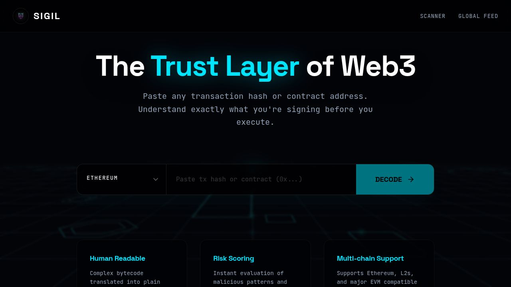

# Sigil Project Overview

Stand: 7. Oktober 2026
Produktions-URL: [sigil.s3ntrylabs.com](https://sigil.s3ntrylabs.com)  
Chrome Web Store: [Sigil - Web3 Trust Layer](https://chromewebstore.google.com/detail/sigil-web3-trust-layer/klogkofhnlifhakklkjmoofhfopnhnkg)

> Statushinweis: Dieses Dokument beschreibt den aktuellen Repository-Worktree. Findings-v2 und rein beratende Execution-Checks sind lokal implementiert; Extension 1.0.4 ist paketiert, aber noch nicht im Store veroeffentlicht oder produktiv/manuell geprueft. Lokale Typpruefungen, Builds und synthetische Desktop-/Mobil-Browsertests bestehen. Der historische Store-Build ist kein Nachweis fuer dieses Update. Die EU/DE-Audit-Entscheidung `NO_GO` bleibt bis zur Gate-Neubewertung und den offenen organisatorischen Nachweisen bestehen. Details: `.compliance/ANALYSIS_QUALITY_2026-10-07.md`.

## 1. README / Projektbeschreibung

**Sigil** ist die Web3-Sicherheitsplattform von S3ntryLabs. Das Produkt soll Nutzern helfen, Wallet-, Vertrags- und Transaktionsrisiken zu verstehen, bevor sie eine Signatur oder Transaktion bestaetigen.

Kernpositionierung:

> Understand wallet and transaction risk before you sign.

Sigil besteht aus drei zusammenhaengenden Produktflaechen:

1. **Web-App:** Analysekonsole fuer Transaktionen, Smart Contracts, Signaturdaten, Freigaben, Wallet-Exposition und oeffentliche Bedrohungsinformationen.
2. **Chrome Extension:** Best-effort-Beobachtung kompatibler EIP-1193-Wallet-Anfragen mit lokalen beratenden Checks und kontextbezogenen Warnungen sowie Copy/Paste-, Website- und Session-Werkzeugen.
3. **API/Backend:** Normalisierung von On-Chain-Daten, deterministische Risikoerkennung, AI-gestuetzte Erklaerungen, Freigabeanalyse und Speicherung freigegebener Analyseergebnisse.

Sigil ist kein Wallet, verwahrt keine Seed Phrases oder Private Keys und soll keine Transaktion selbst autorisieren. Es ist ein beratendes Sicherheitsprodukt und ersetzt weder Wallet-Bestaetigungen noch professionelle Sicherheits-, Rechts- oder Finanzberatung.

Im lokal implementierten Update wird der originale Wallet-Provider pro umschlossener Anfrage exakt einmal und unabhaengig von Sigil-Beobachtungen, UI und Netzwerkanalyse ausgefuehrt. Sigil hat keine Blockier-, Proceed- oder Cancel-Autoritaet; allein das Wallet genehmigt oder lehnt ab. Eine boesartige Seite kann Beobachtungen unterdruecken oder faelschen. Die Analyse kann erst nach Wallet-Prompt oder Bestaetigung fertig werden. "Before you sign" beschreibt das Ziel der Risikopruefung, keine garantierte Abdeckung oder Latenz.

## 2. Aktueller Feature-Stand

### Web-App

| Bereich | Stand | Aktuelle Funktion |
| --- | --- | --- |
| Scanner | Implementiert | Analysiert EVM-Transaktions-Hashes und Contract-Adressen mit Streaming-Ausgabe, Risikoscore, Verdict, Warnungen und positiven Signalen. |
| Read-only Execution Check | Lokal implementiert; Produktionspruefung offen | Strukturiertes JSON kann einen blockgebundenen `eth_call` ausloesen. Reine Calldata/Prosa bleibt beratend; fehlende Daten werden als unavailable ausgewiesen. Keine vollstaendige Simulation, Balance-Deltas oder erfundenen Effekt-/Sicherheits-Scores. |
| Contract Risk | Implementiert | Verifikations-, Bytecode-, Proxy-, bekannte Entitaeten- und Reputationssignale. |
| Approval Inspector | Implementiert | Erkennt Approval-Operationen, Spender, unbegrenzte Freigaben und bekannte Gegenparteien. |
| Approval Health Check | Implementiert | Scannt eine manuell eingegebene oeffentliche Wallet-Adresse und priorisiert aktive, riskante oder unbegrenzte Approvals. |
| Wallet Monitor v1 | Implementiert | Lokale Watchlist, Approval-basierter Hygiene-Score und priorisierte "Fix this first"-Liste. |
| Address Watchlist | Implementiert | Wallets, Vaults, Multisigs und Contracts lokal speichern, aktualisieren sowie als JSON importieren/exportieren. |
| Site Reputation | Implementiert | Schneller lokaler Heuristik-Check fuer bekannte Domains, verdachtige Clone-Muster und unbekannte Sites. |
| History / Intel Feed | Lokal implementiert; Produktionspruefung offen | Oeffentliche Historie zeigt nur kuratierte Hall-of-Shame-Faelle. Nicht kuratierte gespeicherte Analysen sind ueber private UUID-Links abrufbar, nicht als globale Nutzerhistorie. Wer einen Link besitzt, kann das Ergebnis waehrend der Aufbewahrung abrufen; kein kontobasierter Zugriffsschutz. |
| Contract Diff | Implementiert | Vergleicht EIP-1967-Proxy-Implementierungen und hebt Aenderungsrisiken hervor. |
| Onboarding | Implementiert | Kurzer Lernpfad zu Approvals, Signaturen, Verdicts, Extension und Wallet Monitor. |
| Rechtliche Seiten | Implementiert, Review offen | Impressum, Datenschutz, Nutzungsbedingungen und Cookie-/Local-Storage-Hinweise sind als App-Routen vorhanden. |

### Chrome Extension

| Bereich | Stand | Aktuelle Funktion |
| --- | --- | --- |
| Chrome Web Store | Historischer Build live; 1.0.4 ausstehend | Der historische Manifest-V3-Build ist veroeffentlicht. Das lokal paketierte Advisory-/Execution-Check-Update 1.0.4 ist noch nicht veroeffentlicht. |
| Wallet-Methodenerkennung | Lokal implementiert; manuelle QA offen | Beobachtet kompatible `eth_sendTransaction`, `eth_signTransaction`, `eth_sign`, `personal_sign` und `eth_signTypedData*`-Anfragen auf best-effort-Basis; keine Vollstaendigkeitsgarantie. |
| Lokale beratende Checks | Lokal implementiert | Methodenspezifische Regeln, Approval-/Typed-Data-Signale und lokale Site-Reputation ohne Wallet-Gating oder Timing-Garantie. |
| API-Analyse | Implementiert | Uebergibt geeignete Beobachtungen an die Sigil-Produktions-API. |
| Popup-Werkzeuge | Implementiert | Site Check, Copy/Paste Analyzer, History, dApp Sessions, Trusted Sites/Contracts und Einstellungen. |
| Einstellungen-Sync | Implementiert | Optionaler Chrome-Sync fuer Einstellungen und Vertrauenslisten; Analyse- und Session-Historie bleibt lokal. |
| Notification Policy | Implementiert | Critical only, wichtige Risiken oder Off, ohne zusaetzliche Notification-Berechtigung. |
| Security Remediation | **Lokal implementiert; Release-/Produktions-/manuelle QA offen** | Rein beratende Beobachtung statt `sigil:decision`-Gating: originaler Provider exakt einmal, unabhaengig von Sigil-UI, Beobachtungen und Netzwerk. Begrenzte untrusted Intake-Daten, Advisory-Overlay ohne Proceed/Cancel, Session-Zustaende fuer Beobachtung, Review, Dismissal und Analysefehler. Eine Seite kann weiterhin Beobachtungen unterdruecken oder faelschen; diese erhalten keine Wallet-Autoritaet. |

### Backend und Betrieb

| Bereich | Stand |
| --- | --- |
| Vercel Web/API Deployment | Implementiert und zuvor produktiv verifiziert; erneuter Release-Smoke-Test nach der Security-Sanierung erforderlich. |
| Neon PostgreSQL | Integriert; `/api/readyz` meldete zuletzt `database.status: ready`. |
| CORS, Helmet, Rate Limiting | Implementiert. |
| Analyse-Retention | Im aktuellen Audit-Worktree auf konfigurierbare 30 Tage ausgerichtet. |
| Oeffentliche Analyse-Links | Umstellung auf nicht erratbare Public IDs befindet sich im aktuellen Audit-Worktree und muss noch sauber committed, deployed und migriert werden. |

## 3. Tech Stack

| Schicht | Technologie |
| --- | --- |
| Monorepo | pnpm Workspaces |
| Runtime / Sprache | Node.js 24, TypeScript 5.9, Vanilla JavaScript fuer die Extension |
| Frontend | React 19, Vite 7, Wouter, TanStack React Query |
| UI | Tailwind CSS 4, Radix UI, Lucide Icons, Framer Motion, Recharts |
| Backend | Express 5, Vercel Serverless Functions, esbuild |
| Datenbank | Neon PostgreSQL, Drizzle ORM, `pg` |
| API-Vertrag | OpenAPI, Orval, Zod-generierte Schemas |
| AI | OpenAI-kompatibler Client ueber OpenRouter; Standardmodell `deepseek/deepseek-v4-flash` (kostenpflichtig; Produktionswechsel und Test noch zu bestaetigen) |
| Blockchain | Etherscan V2 sowie oeffentliche EVM JSON-RPC-Endpunkte |
| Extension | Chrome Manifest V3, Service Worker, Main-World- und Isolated-World-Content-Scripts, Chrome Storage |
| Deployment | Vercel fuer Web-App und API, Neon fuer PostgreSQL |
| Tests | Node Test Runner, TypeScript-Typechecks, Build- und Store-Readiness-Checks |

Wichtige Verzeichnisse:

```text
artifacts/sigil/             React-Web-App
artifacts/api-server/        Express-API
artifacts/sigil-extension/   Chrome-Extension
lib/api-spec/                OpenAPI-Vertrag
lib/api-client-react/        generierter React-API-Client
lib/api-zod/                 generierte Validierungsschemas
lib/db/                      Drizzle-Schema und Datenbankzugriff
docs/                        Produkt-, Release- und Implementierungsdokumente
.compliance/                 EU/DE-Audit und Release-Gates
```

## 4. Screenshots oder UI



Die produktive UI ist direkt ueber folgende Routen pruefbar:

| UI | URL |
| --- | --- |
| Scanner / Start | [sigil.s3ntrylabs.com](https://sigil.s3ntrylabs.com) |
| Approval Health Check | [sigil.s3ntrylabs.com/approvals](https://sigil.s3ntrylabs.com/approvals) |
| Wallet Monitor | [sigil.s3ntrylabs.com/monitor](https://sigil.s3ntrylabs.com/monitor) |
| Address Watchlist | [sigil.s3ntrylabs.com/watchlist](https://sigil.s3ntrylabs.com/watchlist) |
| Site Reputation | [sigil.s3ntrylabs.com/sites](https://sigil.s3ntrylabs.com/sites) |
| Simulation | [sigil.s3ntrylabs.com/simulate](https://sigil.s3ntrylabs.com/simulate) |
| Intel History | [sigil.s3ntrylabs.com/history](https://sigil.s3ntrylabs.com/history) |
| Extension | [sigil.s3ntrylabs.com/extension](https://sigil.s3ntrylabs.com/extension) |
| Onboarding | [sigil.s3ntrylabs.com/onboarding](https://sigil.s3ntrylabs.com/onboarding) |

Repository-Assets liegen unter `artifacts/sigil/public/` und Extension-Icons unter `artifacts/sigil-extension/icons/`. Ein aktueller, versionierter Screenshot-Satz fuer Desktop, Mobile und Chrome-Store-UI ist noch nicht im Repository gepflegt und sollte im finalen Release-QA aktualisiert werden.

## 5. Datenquellen / APIs

| Quelle | Verwendung | Daten / Hinweise |
| --- | --- | --- |
| Etherscan V2 | Contract-Metadaten, Verifikation, ABI, Token- und Approval-bezogene Explorer-Daten | Benoetigt `ETHERSCAN_API_KEY`; kein Dummy-Key-Fallback. |
| Public EVM JSON-RPC | Transaktionen, Receipts, Bytecode, Storage und On-Chain-Abfragen | Mehrere Fallback-Endpunkte fuer Ethereum, Polygon, Arbitrum, Optimism, Base, BNB Chain sowie Testnetze. |
| CoinGecko Free API | Token-Preise fuer Simulation und Asset-Darstellung | `token-price.ts` fragt direkt ab, ohne TTL-Cache oder Request-Coalescing; bei Fehlern koennen Preise fehlen. Der separate Analyse-Cache ist kein Token-Preis-Cache. |
| OpenRouter / Modellprovider | Kontextgebundene Sicherheitsanalyse und Klartext-Erklaerung | OpenAI-kompatible Konfiguration ueber `AI_INTEGRATIONS_OPENAI_BASE_URL`, `AI_INTEGRATIONS_OPENAI_API_KEY` und optional `SIGIL_AI_MODEL`. |
| Neon PostgreSQL | Persistente Analyseergebnisse und Hall-of-Shame-Daten | Verbindung ueber `DATABASE_URL`; Drizzle ORM. |
| Interne Known-Entity-Daten | Bekannte Protokolle, Exploiter und sanktionierte Adressen | Statisch versionierte Daten im Repository; kein Ersatz fuer eine laufend gepflegte Threat-Intel-Quelle. |
| Lokaler Browser-Speicher | Watchlist, Wallet Monitor, Onboarding, Extension-Historie und Sessions | Web-App nutzt `localStorage`; Extension nutzt `chrome.storage.local` und optional `chrome.storage.sync`. |

Aktuell in den UIs verwendete EVM-Netzwerke sind Ethereum, Polygon, Arbitrum, Optimism, Base, BNB Chain und Sepolia; einzelne Scanner-Oberflaechen bieten derzeit nur die fuenf produktiven Kernnetze an. Die Backend-RPC-Schicht kennt zusaetzlich Goerli.

## 6. Was tatsaechlich schon funktioniert

Nach Code- und Testbestand sind folgende End-to-End-Bausteine vorhanden:

- Eingabe und Klassifikation von Transaction Hashes, Contract-Adressen und rohen Signing-/Transaktionsdaten.
- Streaming-Analyse ueber `/api/sigil/analyze-stream` und normale Analyse ueber `/api/sigil/analyze`.
- Deterministische Risiko-, Approval-, Pattern-, Known-Entity- und OFAC-Pruefungen mit AI-gestuetzter Erklaerung.
- Abruf von EVM-Daten ueber RPC/Etherscan und Preisabfragen ueber CoinGecko.
- Speicherung und Abruf von Analysen ueber PostgreSQL sowie Health-/Readiness-Endpunkte.
- Approval Health Check mit Health Score, unbegrenzten Freigaben, Risikopriorisierung und Revoke.cash-Handoff.
- Lokale Watchlist und Wallet Monitor v1 mit Import/Export und Fix-first-Priorisierung.
- Lokaler Site-Reputation-Check und Copy/Paste-Klassifikation.
- Onboarding-, Extension-, Legal-, History-, Simulation- und Analyseansichten in der Web-App.
- Extension-Popup, lokale Historie, dApp-Session-Zusammenfassungen, optionale Settings-Synchronisierung und API-Handoff.
- Lokal implementierte beratende Best-effort-Beobachtung kompatibler Wallet-Anfragen, ohne Wallet-Entscheidungsautoritaet; Analyse kann nach Prompt/Bestaetigung eintreffen.
- Historisches Chrome-Store-Listing und produktive API-Domain-Konfiguration; Update 1.0.3 noch nicht veroeffentlicht.

Wichtige Einschraenkung: "Implementiert" bedeutet, dass der entsprechende Codepfad vorhanden und teilweise automatisiert getestet ist. Es bedeutet nicht, dass jeder externe Provider, jedes Netzwerk oder jeder produktive Browserpfad aktuell verifiziert ist. Am 30. September 2026 bestanden Workspace-Typecheck sowie API- und Web-Produktionsbuild; TLS-Verifikation blieb aktiviert. Produktive Wallet-, Datenbank- und Provider-Pruefungen stehen aus.

## 7. Was bisher nur geplant ist

### Lokal umgesetzt, Release-Verifikation noch ausstehend

- Lokal implementiert: rein beratendes Modell, originaler Wallet-Provider exakt einmal und unabhaengig von Sigil; keine Blockier-, Proceed- oder Cancel-Autoritaet. Unterdrueckte oder gefaelschte Beobachtungen bleiben moeglich, steuern aber nicht die Wallet-Ausfuehrung.
- Lokal implementiert: Untrusted-Observation-Gate mit Groessen-, Tiefen-, Alters-, Rate-, Queue- und Deduplication-Limits sowie Advisory-Overlay ohne Wallet-Steuerung und beobachtungsbezogenen Session-Zustaenden.
- Lokal verifiziert: Update-Paket 1.0.3 zweimal reproduzierbar erzeugt; SHA-256 `9DB2340A093D84CB7155FBAB66C9FF3BEDBDB3223CDF3FABE3067B922CEF030B`. Store-Einreichung und Veroeffentlichung stehen aus.
- Ausstehend: Produktions-Smoke-Tests und manuelle QA im echten Chrome-Profil fuer kompatible Wallets, gefaelschte/unterdrueckte Beobachtungen, API-Ausfall, Trusted Lists und verspaetete Analyse.
- Ausstehend: Security-Regressionsergebnisse und organisatorische Nachweise fuer die Neubewertung des EU/DE-Release-Gates konsolidieren. Lokale Implementierung allein hebt `NO_GO` nicht auf.

### Premium Wallet Monitor

- Optionale Wallet-Verbindung nur zur bequemeren Auswahl oeffentlicher Adressen, ohne Custody oder Signing-Rechte.
- Scam-Interaction-Historie und verdachtige Contract-Exposition ueber Approval-Daten hinaus.
- Laufende Alerts fuer neue kritische Expositionen und Risk-Aenderungen.
- Free-, Sigil-Plus- und Sigil-Pro-Limits sowie Billing/Entitlements.
- Mehrere Wallets, tiefere Historie, erweiterte Alerts und exportierbare Pro-Reports.

### Security Decision Assistant

- Kontextgebundener Assistent in Transaktions-, Contract-, Approval-, Paste- und Wallet-Monitor-Ergebnissen.
- Vordefinierte Sicherheitsfragen, Grounding in Sigil-Signalen und klare Grenzen gegen Trading-, Investment-, Steuer- und allgemeine Web3-Beratung.
- Qualitaets- und Safety-Evaluationen sowie gestaffelte Free/Plus/Pro-Nutzung.

### Spaetere Integration und Intelligence

- Stabile, authentifizierte und monetarisierte Team/API-Oberflaeche ab EUR 99/Monat.
- JavaScript SDK, Wallet-/dApp-Adapter, signierter Threat-Signal-Feed und Partner-Integrationen.
- Erweiterte Threat-Intel-Registry, Contract-Upgrade-Monitoring und historische Exploit-Regressionstests.
- Community Threat Reports mit interner Pruefung und optionale Webhooks.
- Mobile App, Hardware-Wallet-Plugins, DAO Threat Intelligence und Mempool-Produkt bleiben bewusst zurueckgestellt.

## Verbindliche Statusquellen

- Produkt-Roadmap: [`sigil-whitepaper.md`](sigil-whitepaper.md#17-roadmap)
- Aktuelles Security-Design: [`docs/superpowers/specs/2026-09-28-advisory-extension-security-design.md`](docs/superpowers/specs/2026-09-28-advisory-extension-security-design.md)
- EU/DE-Release-Audit: [`.compliance/COMPLIANCE_AUDIT.md`](.compliance/COMPLIANCE_AUDIT.md)
- Release-Checkliste: [`.compliance/RELEASE_CHECKLIST.md`](.compliance/RELEASE_CHECKLIST.md)
- Chrome-Store-Unterlagen: [`docs/chrome-web-store-submission.md`](docs/chrome-web-store-submission.md)
- Production-QA: [`docs/production-qa-matrix.md`](docs/production-qa-matrix.md)
